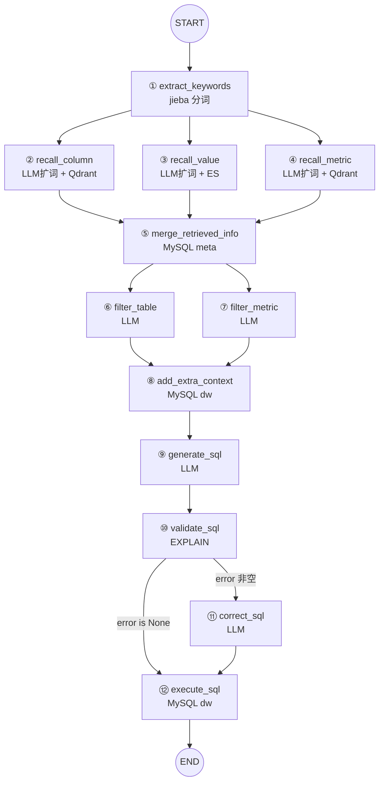
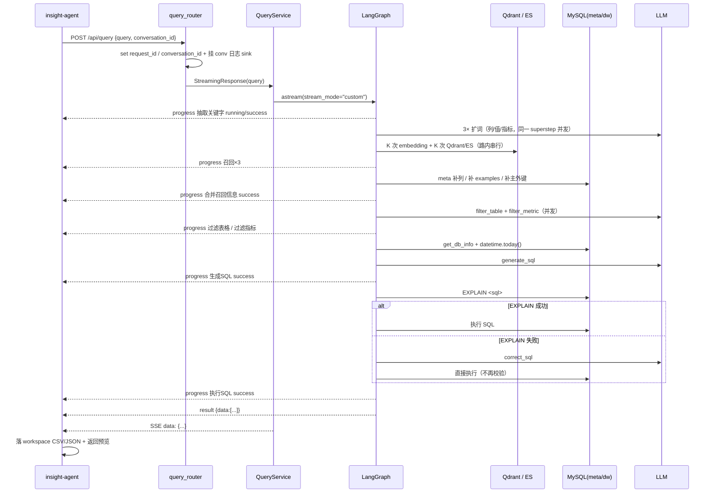

# data-agent · Agent 模块架构与单轮调用全流程

> 分析对象：`G:\tearcher_code\insight\data-agent`
> 分析范围：`app/agent/**`（图编排 + 12 节点 + State/Context/LLM），以及支撑单轮调用闭环的
> `app/api/**`、`app/services/query_service.py`、`app/repositories/**`、`app/clients/**`、`prompts/**`、`conf/**`
> 分析方式：全量源码直读（非估算）。代码基线含 2026-06-08 / 06-09 的跨项目补丁注释。

---

## 0. 结论速览

| 维度 | 结论 |
|---|---|
| 定位 | **无状态单轮 NL2SQL Agent**，对外只暴露 `POST /api/query`，SSE 流式返回 |
| 编排 | LangGraph `StateGraph`，**12 节点 / 1 个条件边 / 无环**（correct_sql 后不回跳校验） |
| 架构分层 | State（数据）/ Context（依赖）/ Node（行为）三者物理隔离 —— 这是本模块最干净的设计决策 |
| 一条查询的 LLM 调用 | 正常 6 次，SQL 校验失败 7 次，硬上限 7 次 |
| 一条查询的远端 RPC | 典型 ~50 次（embedding 20 + Qdrant 20 + ES 10），**路内全串行** |
| 记忆 | **零**。无 checkpointer、无会话状态；多轮上下文完全由上游 insight-agent 承担 |
| 最大性能瓶颈 | 3 路召回节点内 `for keyword: await` 串行，无 embedding 批量、无 Qdrant batch |
| 最大安全风险 | `execute_sql` 用 **root 账号**直执 LLM 生成的原始 SQL，仅靠 prompt 约束，无只读隔离/语句白名单 |
| 最大健壮性缺口 | LLM 输出 JSON 解析失败 → 节点直接 `raise` → 整个请求中断，无降级 |

---

## 1. 模块定位与边界

```
insight-agent (Agent 层 · 有记忆/有工具)
      │  tools/db_query.py  取 workspace_dir 末段当 conversation_id
      ▼  HTTP POST /api/query  body={query, conversation_id}  accept: text/event-stream
┌──────────────────────────────────────────────────────────┐
│ data-agent（本模块）                                      │
│  main.py  FastAPI + request_id 中间件                     │
│   └ query_router  注入 conversation_id → 动态日志 sink     │
│      └ QueryService  组装 DataAgentContext                │
│         └ LangGraph StateGraph  ←── 12 节点，无状态       │
│            ├ Qdrant ×2 collection（字段向量 / 指标向量）   │
│            ├ Elasticsearch ×1 index（字段取值全文）        │
│            ├ MySQL meta（元数据，4 表）                    │
│            └ MySQL dw（数仓，25 表）                       │
└──────────────────────────────────────────────────────────┘
```

**边界结论**：data-agent 是**纯无状态服务**。`graph.compile()` 未传 checkpointer，`DataAgentState` 每次请求从 `{"query": ...}` 冷启。
单轮是它的**全部**语义单元 —— 它不感知上一轮问过什么，追问、指代消解、多轮改写全部由 insight-agent 侧完成。

---

## 2. 目录与模块清单

```
data-agent/
├── main.py                              FastAPI 入口 + request_id 中间件
├── app/
│   ├── agent/                           ★ 本模块核心
│   │   ├── graph.py                     图编排（节点注册 + 边 + 条件边）
│   │   ├── state.py                     DataAgentState 等 6 个 TypedDict
│   │   ├── context.py                   DataAgentContext（6 个运行时依赖）
│   │   ├── llm.py                       init_chat_model，temperature=0
│   │   └── nodes/                       12 个节点
│   ├── api/
│   │   ├── routers/query_router.py      唯一路由
│   │   ├── schemas/query_schema.py      QuerySchema{query, conversation_id?}
│   │   └── dependencies.py              6 个 Depends + get_query_service
│   ├── services/query_service.py        graph.astream → SSE 编码
│   ├── services/meta_knowledge_service.py  离线知识库构建（非在线链路）
│   ├── repositories/                    es / qdrant×2 / mysql(meta,dw)
│   ├── entities/                        ColumnInfo / TableInfo / MetricInfo / ValueInfo / ColumnMetric
│   ├── models/                          SQLAlchemy ORM（meta 库 4 表）
│   ├── clients/                         embedding / es / mysql×2 / qdrant
│   ├── conf/                            app_config / meta_config 的 dataclass 映射
│   ├── core/                            log（按 conv 分文件）/ context / lifespan
│   └── scripts/                         init_db.py / build_meta_knowledge.py
├── prompts/                             7 个 .prompt（5 个在线用到）
└── conf/                                app_config.yaml / meta_config.yaml
```

**在线链路用到的 prompt**（5 个）：`extend_keywords_for_column_recall`、`extend_keywords_for_value_recall`、`extend_keywords_for_metric_recall`、`filter_table_info`、`filter_metric_info`、`generate_sql`、`correct_sql` —— 实为 7 个。

---

## 3. 核心抽象：State / Context / Node 三层解耦

这是本模块最值得复用的设计。

### 3.1 `DataAgentState` —— 只装数据，不装依赖

```python
class DataAgentState(TypedDict):
    query: str                                   # 输入
    keywords: list[str]                          # jieba + 全文 + LLM 扩展词
    retrieved_columns: list[ColumnInfo]          # 3 路召回产物
    retrieved_values:  list[ValueInfo]
    retrieved_metrics: list[MetricInfo]
    table_infos:  list[TableInfoState]           # 合并 + 过滤后的 schema
    metric_infos: list[MetricInfoState]
    date_info: DateInfoState                     # {date, weekday, quarter}
    db_info:   DBInfoState                       # {dialect, version}
    sql:   str                                   # 生成的 SQL
    error: str                                   # validate 失败原因（条件边路由依据）
```

要点：
- `ColumnInfoState` / `TableInfoState` / `MetricInfoState` 是**面向 prompt 的裁剪视图**（`ColumnInfo` 里 `id`/`table_id` 这类内部字段被剥掉），避免把无用字段塞进 prompt 浪费 token。
- `retrieved_*`（召回原始实体）与 `table_infos`（可序列化视图）**分离**，前者供程序逻辑用，后者只供 `yaml.dump` 进 prompt。

### 3.2 `DataAgentContext` —— 依赖注入容器

```python
class DataAgentContext(TypedDict):
    embedding_client: EmbeddingClient
    column_qdrant_repository / value_es_repository / metric_qdrant_repository
    meta_mysql_repository / dw_mysql_repository
```

6 个依赖全为**进程级单例**（client manager 在 `lifespan` init），每节点通过 `runtime.context["..."]` 取用。

**唯一会话级依赖是 session**：`dependencies.py` 中 `get_meta_session` / `get_dw_session` 用 `async with ... as session` 生成器，**每请求开 2 个新 DB session**，随请求结束释放。这直接决定了 `graph.py` 的 `__main__` 测试块必须手动 `async with` 两个 session —— 因为 Repo 是 session-scoped 的。

### 3.3 节点签名统一

```python
async def node(state: DataAgentState, runtime: Runtime[DataAgentContext]):
    writer = runtime.stream_writer
    writer({"type": "progress", "step": "...", "status": "running"})
    ...
    return {partial_state}      # 增量更新，LangGraph 按 key 归并
```

统一 4 段式：`emit running → 取 context 依赖 → try 业务 → emit success/error`。
**注意**：`validate_sql` 是唯一把异常吞掉转成 `{"error": str(e)}` 的节点（因为它是路由判据），其余 11 个节点一律 `raise` 上抛。

---

## 4. 图拓扑



**拓扑三条硬事实**：

1. **两次 fan-out / fan-in**
   - fan-out#1：`extract_keywords` → 3 路召回；fan-in：3 路 → `merge_retrieved_info`
   - fan-out#2：`merge` → `filter_table` + `filter_metric`；fan-in：二者 → `add_extra_context`
   同 superstep 内并发执行，下一 superstep 汇合触发。

2. **只有 1 个条件边，且是单次单向**
   ```python
   graph_builder.add_conditional_edges(
       "validate_sql",
       lambda state: "execute_sql" if state["error"] is None else "correct_sql",
       {"execute_sql": "execute_sql", "correct_sql": "correct_sql"},
   )
   graph_builder.add_edge("correct_sql", "execute_sql")   # ← 不回 validate
   ```
   **纠错是一次性的**。`correct_sql` 输出的 SQL 不再过 `EXPLAIN`，直接执行。若模型二次仍写错，只能由 `execute_sql` 抛异常、发 `error` chunk 结束。这是当前设计里最值得立刻改的一处（加 `correct_sql → validate_sql` 回边会引入环与轮次上限，需配 `recursion_limit` 与重试计数）。

3. **无环、无 checkpointer、无 interrupt**
   所以不存在人工介入（HITL）点，也无法「暂停-确认 SQL-继续」。若产品需要「执行前给用户看 SQL」，必须引入 `interrupt_before=["execute_sql"]` + checkpointer。

---

## 5. 单轮调用完整业务流程（端到端）

### 阶段 S0 · HTTP 接入与请求隔离

| 步 | 位置 | 行为 |
|---|---|---|
| 0.1 | `main.py` 中间件 | `request_id_ctx_var.set(uuid4())` —— 每请求唯一 ID |
| 0.2 | `query_router.query` | `QuerySchema` 校验；若带 `conversation_id` 则 `conversation_id_ctx_var.set(...)` + `ensure_conv_logger(id)` **动态挂 loguru sink** `logs/conv-{id}.log` |
| 0.3 | 返回类型 | `StreamingResponse(..., media_type="text/event-stream")` —— 立即建流，业务在生成器内惰性执行 |
| 0.4 | `dependencies.get_query_service` | 构造 2 个 DB session + 4 个 client 引用 → `QueryService` |

**注意**：`ensure_conv_logger` 是首见即挂、**永不卸载**。长期运行下 `_conv_sinks` 无上限增长，每条日志要过 N 个 filter，存在缓慢性能退化与 `logs/conv-*.log` 无限膨胀（注释明确写了"不限制大小"）。

### 阶段 S1 · S0 业务起点 —— 关键词抽取（无 LLM）

```
节点 ① extract_keywords  [jieba，本地 CPU，无网络]
  入：state["query"]
  处理：jieba.analyse.extract_tags(query, allowPOS=(n,nr,ns,nt,nz,v,vn,a,an,eng,i,l))
  出：keywords = list(set(tags + [query]))          # 原始 query 被整体塞进关键词集合
```

设计判断：
- 用 jieba 而非 LLM 做首轮分词 —— **省一次 LLM 调用**，且分词结果作为「召回集合的基座」稳定可控。
- 把**整句 query 也作为 keyword**：兜底保护，防止分词把关键短语切碎导致漏召回。代价是多一次 embedding + 一次检索。
- `allowPOS` 白名单设计得很细（含 `eng` 英文、`nz` 专有名词），针对中文数仓术语场景。

SSE：`{"type":"progress","step":"抽取关键字","status":"running"}` → `"success"`

### 阶段 S2 · 三路并行召回（同一 superstep 并发）

三条边同源，LangGraph 在**同一 superstep 用 asyncio 并发**执行 ②③④。三路互不读写对方 state key，无冲突。

#### ② recall_column —— Schema 层语义召回（Qdrant 向量）

```
入：query, keywords, context.embedding_client, context.column_qdrant_repository
1) LLM 扩词：prompt=extend_keywords_for_column_recall → JsonOutputParser → list[str]
   （prompt 约束输出「字段名级业务语义」，禁字段取值/表名/SQL）
2) keywords = set(keywords + LLM结果)
3) for kw in keywords:                          ← 串行
       emb = await embedding_client.aembed_query(kw)          # 1 次 HTTP
       cols = await column_qdrant_repository.search(emb)      # 1 次 Qdrant
   去重：dict[column_id → ColumnInfo]
出：retrieved_columns
```

#### ③ recall_value —— 取值层全文召回（ES）

与 ② 同构，但第 3 步是 `value_es_repository.search(kw)`，走 `ik_max_word` 分词器的 `match` 查询。
产出 `ValueInfo{id, value, column_id}` —— 用来把「用户口中的业务实体词」（如某省份名、某状态名）反查到具体列。

#### ④ recall_metric —— 指标层语义召回（Qdrant 向量）

与 ② 同构，换 `metric_qdrant_repository`。产出 `MetricInfo{id, name, description, relevant_columns, alias}`。

**三路统一参数（硬编码在 Repository 默认值，不可配置）**：
- Qdrant：`score_threshold=0.6`，`limit=5`，`Distance.COSINE`，向量维度 1024（`bge-large-zh-v1.5`）
- ES：`min_score=0.6`，`size=5`

SSE：三条 `recall_*` 的 running/success 事件按完成顺序交错写入流。

### 阶段 S3 · 合并与 schema 补全（纯程序逻辑，无 LLM）

```
节点 ⑤ merge_retrieved_info   [MySQL meta 查询]
入：retrieved_columns / retrieved_values / retrieved_metrics
处理四步：
  1) 指标驱动补列：对每个 retrieved_metric 的 relevant_columns 中未命中的列，
     meta_mysql_repository.get_column_info_by_id(id)   ← 保证「指标口径所需字段」一定在 schema 里
  2) 取值驱动补列 + 填 examples：对每个 retrieved_value 的 column_id 未命中则补列；
     命中则把 value 追加进 column.examples        ← 让 LLM 看到真实枚举值
  3) 按 column.table_id 分组 → 每张入选表强制补齐 primary_key / foreign_key
     （get_key_columns_by_table_id）              ← 保证 LLM 有 JOIN 依据
  4) 转 list[TableInfoState] / list[MetricInfoState]（剥掉 id/table_id）
出：table_infos, metric_infos
```

**这是整个 Agent 的「schema 收敛枢纽」**，三个设计点很有价值：
- **指标 → 列的强制补全**：向量召回可能只命中指标名，但指标定义依赖的列必须一起给 LLM，否则口径落不了地。
- **取值 → examples 回填**：把 ES 召回的实体词写进列的 `examples`，让 LLM 生成 `WHERE status='退款成功'` 这类正确枚举过滤。
- **主外键强制注入**：这是「多表 JOIN 成功率」的关键兜底 —— 召回的列往往只有度量列，没有关联键。

**代价**：MySQL 查询次数随召回规模线性增长（每次未命中列 1 次 `session.get`、每表 2 次查询），是隐藏的 N+1 模式。

### 阶段 S4 · 双路 Schema 裁剪（LLM 语义过滤）

`table_infos` 与 `metric_infos` 已各自就绪，两条边并发：

```
节点 ⑥ filter_table   prompt=filter_table_info
  入参：query + yaml.dump(table_infos)
  出参（严格 JSON）：{"表名1": ["字段1","字段2"], "表名2": [...]}
  后处理：原地 remove 不在结果中的表；对入选表原地 remove 不在列表中的列

节点 ⑦ filter_metric  prompt=filter_metric_info
  入参：query + yaml.dump(metric_infos)
  出参（JSON 数组）：["指标名1","指标名2"]  （允许 []）
  后处理：原地 remove 不在数组中的指标
```

设计判断：
- 这一步是**上下文压缩的核心**：把宽召回（每表十几列）裁到「回答该问题必需」的最小集，直接决定 `generate_sql` 的 prompt 体积与准确率。
- prompt 反复强调「不做兜底保留、不做冗余保留」「能用一个指标就不得选多个」—— 这是**反幻觉**取向：宁可少给，不给多。
- 用 `yaml.dump(..., allow_unicode=True, sort_keys=False)` 而非 JSON 喂 prompt：字段名含中文，YAML 更省 token 且更可读。
- **风险**：LLM 返回非预期结构时，`if table_info["name"] not in result` 会把表**全部裁掉**（`result` 是 list 时 `in` 语义变成元素判断，全 False），导致下游拿到空 schema 却继续生成 SQL。

### 阶段 S5 · 额外上下文注入（不可省的一步）

```
节点 ⑧ add_extra_context
  date_info = {date: %Y-%m-%d, weekday: %A(英文), quarter: Q{(m-1)//3+1}}   ← 服务端 datetime.today()
  db_info   = dw_mysql_repository.get_db_info()  → {version: select version(), dialect: bind.dialect.name}
出：date_info, db_info
```

设计判断：**当前时间由服务端权威注入，不让 LLM 猜**。这是 NL2SQL 里「时间窗口径错」这类硬错误的根治手段 —— prompt 里第 8 条明确写了「用户说最近 3 个月且当前是 X，则对应 X-3月 ~ X」。`dialect + version` 则是让 LLM 选对 MySQL 方言特性的依据。

### 阶段 S6 · SQL 生成（核心 LLM 调用）

```
节点 ⑨ generate_sql   prompt=generate_sql   output_parser=StrOutputParser
  prompt 五段输入：query / table_infos(YAML) / metric_infos(YAML) / date_info / db_info
  输出：纯 SQL 文本（prompt 第 6 条严禁 ``` 代码块）
出：sql
```

`generate_sql.prompt` 的 11 条约束分两层：

| 层 | 条目 | 性质 |
|---|---|---|
| 通用 | 1 只用真实表字段 / 2 指标口径优先 / 3 只读 / 4 方言匹配 / 5 单条 SQL / 6 纯文本输出 | 可跨库复用 |
| **项目特化** | 7 退款状态必须用中文枚举 / 8 时间过滤必须显式写 / 9 `*_amount` 单位是分必须 `*0.01` / 10 退款率口径要写注释 / 11 维表关联字段名 | **硬编码了 `dwd_fact_trade_refund_detail_di`、`province_code`、`region_code`、甚至具体日期 `2026-06-08`** |

**判断**：第 7-11 条把「业务语义修正」直接烧进 prompt，短期见效快（治好了"SQL 语法对、数据错"这类高频坑），但**换一套数仓即失效**，且 prompt 里的具体表名/日期属于会过期的死信息。长期应下沉为 meta_config 里的**列级业务约束元数据**（如 `enum_values`、`unit`、`time_field_hint`），由 `merge_retrieved_info` 动态注入 —— 现有 `alias` / `examples` / `sync` 字段机制已经具备这个扩展位。

### 阶段 S7 · 校验与纠错（唯一分支）

```
节点 ⑩ validate_sql
  await dw_mysql_repository.validate_sql(sql)   →  await session.execute(text(f"explain {sql}"))
  成功 → return {"error": None}
  异常 → return {"error": str(e)}            ← 唯一吞异常的节点
出：error

条件边：error is None → ⑫ execute_sql ；否则 → ⑪ correct_sql

节点 ⑪ correct_sql   prompt=correct_sql   StrOutputParser
  入参：query / table_infos / metric_infos / date_info / db_info / sql / error
  出：sql（覆盖原值）
  prompt 9 条：仅修错误、最小改动、语义不变、不新增 JOIN/子查询
```

**为什么用 `EXPLAIN` 而不是执行**：`EXPLAIN` 会做语义解析 + 表/列存在性校验，但**不返回结果集、不产生副作用**，是低成本的「静态验证」。相比正则解析 SQL，它借用了数据库自身的权威校验器 —— 这个选择是对的。

暴露的问题：
- `except Exception` 不区分「SQL 语法/字段错」与「连接断开/权限不足」。若是连接池打满，会把网络错误当 SQL 错误喂给 LLM 去"修"，浪费一次调用且输出无意义 SQL。
- 纠错后不回跳校验（见 §4.2 第 2 点）。
- `EXPLAIN` 对 `INSERT/UPDATE/DELETE` 同样合法 —— **它不能充当写操作防护**。

### 阶段 S8 · 执行与结果回传

```
节点 ⑫ execute_sql
  result = await dw_mysql_repository.execute_sql(sql)      # text(sql) 直执，mappings() 转 list[dict]
  writer({"type": "progress", "step": "执行SQL", "status": "success"})
  writer({"type": "result",   "data": result})             ← 载荷
  异常 → writer({"type":"progress", ..., "status":"error"})
         writer({"type":"error","step":"执行SQL","error": f"{type(e).__name__}: {e!r}"})
         raise
出：无 state 写入（终点）
```

`QueryService.query` 把每个 chunk 编码为 SSE：

```python
yield f"data: {json.dumps(chunk, ensure_ascii=False, default=str)}\n\n"
```

`default=str` 让 `datetime` / `Decimal` 能落盘不炸 —— 与上游 `db_query.py` 的写文件逻辑一致。

### 阶段 S9 · 上游消费（insight-agent 侧）

```
insight-agent/app/agent/tools/db_query.py
  1) 从 runtime.config["configurable"]["workspace_dir"] 取路径，末段 int() 还原 conversation_id
  2) httpx AsyncClient.stream(POST, DB_QUERY_URL, json={query, conversation_id})
  3) 逐行解析 "data:" 前缀 → json.loads → 按 type 分流
        type == "result" → 取 data 作为最终结果，continue
        type == "error"  → return {"status":"error","message": chunk.get("error", chunk.get("message"))}
        type == "progress" → **被忽略**
  4) data = None → {"status":"error","message":"data query API finished without result"}
  5) 结果落 workspace：list[dict] → CSV（字段名跨行并集）+ 前 5 行预览 + pandas read hint
                       其他    → JSON
  返回 {status, file_path, file_format, pandas_read_hint, fields, preview_rows, row_count}
```

**三处跨项目契约**：
- `error` chunk 的字段是 `error` 或 `message` —— 上游用 `chunk.get("error", chunk.get("message"))` 做了兼容，因为 service 层顶层异常发的是 `{"type":"error","message":...}`，而 `execute_sql` 发的是 `{"type":"error","step":...,"error":...}`。**两处形状不统一是遗留技术债**，靠上游双 key 兜底维持。
- `progress` 事件在 insight-agent 链路里**完全被丢弃**。它只对直连前端（或未来的 UI 流）有价值。
- 上游靠「等 `result` 才收尾」判定结束 —— 所以 `execute_sql` 异常必须发 `type=error`，否则上游会挂到超时（代码注释里记录了 2026-06-08 修复的正是这个点）。

---

## 6. State 演进与依赖矩阵

| state key | 写入者 | 读取者 |
|---|---|---|
| `query` | 入口（`{"query": ...}`） | ②③④⑥⑦⑨⑪ |
| `keywords` | ① | ②③④（各自再叠加 LLM 扩词，**不写回**） |
| `retrieved_columns` | ② | ⑤ |
| `retrieved_values` | ③ | ⑤ |
| `retrieved_metrics` | ④ | ⑤ |
| `table_infos` | ⑤ 初始化 → ⑥ **原地裁** | ⑨⑪ |
| `metric_infos` | ⑤ 初始化 → ⑦ **原地裁** | ⑨⑪ |
| `date_info` / `db_info` | ⑧ | ⑨⑪ |
| `sql` | ⑨ → ⑪ 覆盖 | ⑩⑫ |
| `error` | ⑩ | 条件边 lambda、⑪ |

**风险**：⑥⑦ 用 `list.remove()` **原地修改** state 内的 list 对象，且返回同一个引用。LangGraph 的 channel 是 last-value-wins，原地变更能生效（因为返回了同一对象），但这是**别名污染式写法**，一旦将来加了 checkpointer 做状态快照/回放，或在节点间共享引用，会出现难以定位的串状态。建议改为返回新 list。

---

## 7. 外部依赖与 IO 清单（单轮）

| 依赖 | 端点 / 名称 | 关键参数 | 单轮调用次数（典型） |
|---|---|---|---|
| LLM | `deepseek-v4-flash` @ api.deepseek.com/v1，OpenAI 兼容 | `temperature=0` | **6**（+1 纠错） |
| Embedding | `BAAI/bge-large-zh-v1.5` @ siliconflow | dim 1024，timeout 30s | **~20**（②④ 各 K 次，K≈10） |
| Qdrant | `data-agent-column` / `data-agent-metric` | COSINE, `score_threshold=0.6`, `limit=5` | **~20** |
| Elasticsearch | index `data-agent-value` | `ik_max_word`, `min_score=0.6`, `size=5` | **~10** |
| MySQL meta | db `meta`（table_info / column_info / metric_info / column_metric） | session/请求，`pool_size=10` | ⑤ 主导，**N+1** |
| MySQL dw | db `warehouse`（25 表） | 同上 | 2（`get_db_info` + `EXPLAIN`）+ 1（执行） |
| 本地 CPU | jieba | — | ① |

**元数据规模**（`conf/meta_config.yaml` 实测）：**25 张表 / 458 个字段 / 23 个指标**。

---

## 8. 流式协议

SSE 事件共 4 种形状（实现上 3 类语义）：

```jsonc
// 1. 进度（每个节点 running + success/error，共约 22 条/轮）
{"type":"progress","step":"召回字段","status":"running"}

// 2. 结果（仅 execute_sql 发一次，流终止信号）
{"type":"result","data":[{"region_name":"华东","gmv":"123.45"}]}

// 3. 节点级错误（execute_sql 捕获后发）
{"type":"error","step":"执行SQL","error":"ProgrammingError: ..."}

// 4. 服务级错误（QueryService 顶层兜底）
{"type":"error","message":"..."}
```

**缺口**：
- `progress` 无耗时字段，无法做阶段级性能观测（RPC 延迟、LLM 首 token 时间全丢）。
- 没有 `sql` 事件 —— **生成的 SQL 不回流给上游**，用户与排查者都看不到最终执行的 SQL（只能靠 `logs/conv-{id}.log`）。这是可观测性的最大短板。
- 没有结束标记（`[DONE]`），上游只能以 `result` 或 `error` 判断终止；若 LLM 长期挂起则无超时保护（`astream` 未传 `recursion_limit`，HTTP client 超时仅在 embedding 侧设置）。

---

## 9. 设计取舍评价

### 做得好的

| 决策 | 理由 |
|---|---|
| State / Context / Node 三层物理隔离 | 依赖不进 state，state 可序列化；节点纯函数化，可单测、可换依赖 |
| jieba 打底 + LLM 扩词的混合召回 | 省一次 LLM 调用，且分词基座稳定，不受模型波动影响 |
| 三路召回**正交分解**（字段 / 取值 / 指标） | 三类元知识存储引擎不同（向量 / 全文 / 向量），召回策略本应不同；分开后可独立演进与调参 |
| `merge` 阶段的三条补全规则 | 指标→列、取值→examples、表→主外键 —— 精准命中 NL2SQL 三类高频失败（口径丢字段、枚举写错、JOIN 缺键） |
| 服务端注入 `date_info` / `db_info` | 消除模型对「今天是几号」「什么方言」的幻觉 |
| `EXPLAIN` 做静态验证 | 借 DB 权威解析器，零副作用、低成本 |
| 全链路 `default=str` | `Decimal` / `datetime` 在 metadata 与结果两个方向都不炸 |
| 按 `conversation_id` 分文件日志 | data-agent 无状态，日志是唯一能把一轮调用与某个会话关联起来的载体 —— 与上游 workspace 目录一一对应 |

### 需要收敛的

按优先级排序：

**P0 — 安全**
1. `execute_sql` 用配置里的 **root/明文密码** 直执 LLM 生成的原始 SQL。`EXPLAIN` 不拦写操作，prompt 约束不可信（prompt injection 可从用户 query 侧进入）。
   → 最小改动：DW 连接换**只读账号** + 执行前用 `sqlparse` 取首个 DML 关键字做白名单（仅允许 `SELECT`/`WITH`）+ 强制 `LIMIT` 上限。
2. 密码明文写在 `conf/app_config.yaml`（`123321`），虽有 `${oc.env:...}` 支持 LLM key，DB 凭据未走环境变量。

**P1 — 正确性与健壮性**
3. `correct_sql → execute_sql` 缺少回跳校验，纠错一次即放弃。
4. 所有 LLM 节点的 `JsonOutputParser` 失败即 `raise`，无降级。建议：JSON 解析失败时按「不裁剪」（保留全部候选）降级，而非中断整轮。
5. `filter_table` 在 LLM 返回非 dict 时会把表**全部裁掉**，产出空 schema 仍继续生成 SQL → 必然幻觉。需加「裁剪后为空则回退到裁剪前」的保护。
6. `validate_sql` 的 `except Exception` 混淆 SQL 错误与基础设施错误，污染 `correct_sql` 的上下文。

**P2 — 性能**
7. 3 路召回节点内是 `for keyword: await` **串行**，且 embedding 一次只送 1 条（`aembed_query` 内部包成 `aembed_documents([text])`）。
   → 改成节点内 `asyncio.gather` 对关键词并发；embedding 走 `aembed_documents(batch)` 批量；Qdrant 用 `query_batch_points`。
   预期把 3 路召回的 wall-clock 从「K 次串行 RPC」压到「1-2 次批量 RPC」。
8. `score_threshold=0.6` / `limit=5` 硬编码在 Repository 默认参数，不可配置。召回质量强耦合这两个魔数，调参必须改代码。
9. `merge_retrieved_info` 的 N+1 MySQL 查询；`get_column_info_by_id` / `get_key_columns_by_table_id` 可批量化。
10. `load_prompt()` 每次 `read_text` 无缓存 → 每轮约 7 次磁盘读。`functools.lru_cache` 即可。
11. `_conv_sinks` 只增不减 + `logs/conv-*.log` 无 rotation → 长跑必然退化。

**P3 — 可维护性**
12. `error` chunk 两种形状（`error` vs `message`）靠上游双 key 兜底，应统一。
13. `generate_sql.prompt` / `correct_sql.prompt` 里硬编码具体表名、字段名、日期，业务语义修正应下沉到 `meta_config` 的列级元数据。
14. `graph.compile()` 无 `recursion_limit`、无超时，LLM 挂起即请求挂起。
15. 生成的 SQL 不通过 SSE 回流，可观测性缺失。

---

## 10. 时序图（单轮 happy path）



---

## 11. 附：离线知识库构建（在线链路的前置）

`app/scripts/build_meta_knowledge.py` → `MetaKnowledgeService.build()`，读 `conf/meta_config.yaml`：

```
tables[25] ─┬─→ MySQL meta: table_info + column_info（含真实 type、从 dw 采样 10 条 examples）
            ├─→ Qdrant data-agent-column：
            │     每列生成 1 + 1 + len(alias) 个向量点
            │     （embedding_text = name / description / 各 alias）
            └─→ ES data-agent-value：
                  sync=true 的列，取 dw 中最多 100k 个 distinct 值 → (id="{col}.{value}", value, column_id)
metrics[23] ─┬─→ MySQL meta: metric_info + column_metric（m:n 关联）
             └─→ Qdrant data-agent-metric：同上 1+1+len(alias) 点
```

**这份 pipeline 与在线 3 路召回严格一一对应**：

| 在线节点 | 离线索引 | 索引粒度 |
|---|---|---|
| `recall_column` | Qdrant `data-agent-column` | **字段名 + 描述 + 别名** 三个向量 |
| `recall_value` | ES `data-agent-value` | **字段真实取值**（全文，ik 分词） |
| `recall_metric` | Qdrant `data-agent-metric` | 指标名 + 描述 + 别名 |

这也解释了 `sync: true/false` 的语义：**控制该列是否把取值灌进 ES**（`is_current` / `start_date` / `etl_date` 这类技术列设为 `false`，避免污染取值索引）。
另外 `_serialize_examples` 专门处理 `datetime/date/Decimal → str/float`，说明示例值直接来自数仓原始表，是真的在跑。

---

## 12. 一句话总结

data-agent 的 Agent 部分是一个**「宽召回 → 语义裁剪 → 权威校验」三段式无状态 NL2SQL 图**：
用 jieba + 三路异构召回保证**不遗漏**，用两轮 LLM filter 保证**不超载**，用 MySQL `EXPLAIN` + 一次 LLM 纠错保证**能跑通**。
架构分层干净、元知识三态（向量/全文/关系）设计自洽；短板集中在**执行期安全边界**、**LLM 输出的无降级依赖**、以及**召回路内的串行 RPC**。
