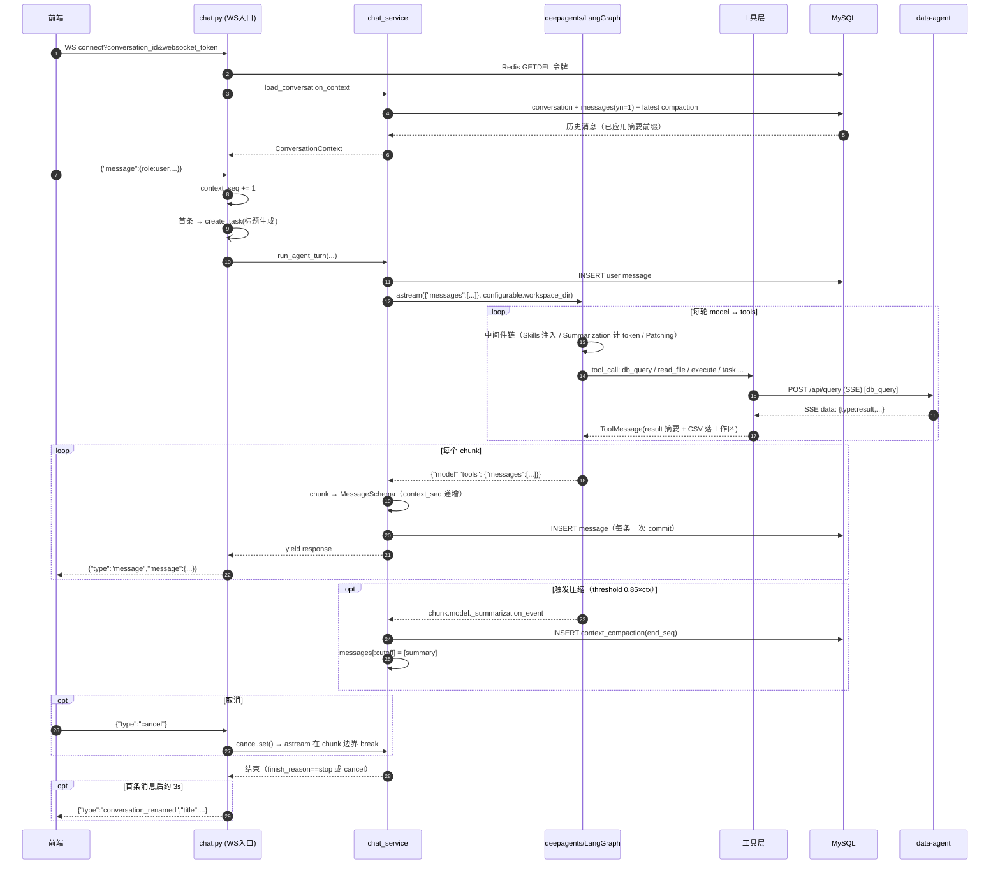

# insight-agent · Agent 架构与单轮调用流程

> 范围：仅 `G:\tearcher_code\insight\insight-agent`（不含 `auth/`、`data-agent/`、`dbmock/`）
> 依据：仓库源码 + `deepagents 0.4.7` 实际安装源码（`.venv/Lib/site-packages/deepagents`）
> 生成时间：2026-09-22

---

## 0. 结论速览

| 维度 | 事实 |
|---|---|
| Agent 框架 | `deepagents 0.4.7`（`create_deep_agent`）→ 底层 `langchain.create_agent` → LangGraph `CompiledStateGraph` |
| 模型 | DeepSeek（OpenAI 兼容协议 `init_chat_model(model_provider="openai")`），`profile.max_input_tokens = 1,048,576` |
| 状态托管 | **LangGraph 无 checkpointer**；会话状态（消息历史 + 压缩摘要）由 insight-agent 自行落 MySQL，每轮重建 |
| Agent 实例 | 进程内**全局单例**（`_agent`），并发首请求由 `asyncio.Lock` 保证只建一次 |
| 文件系统 | `CompositeBackend(default=LocalShellBackend(会话工作区), routes={"/skills/": FilesystemBackend})` |
| 工具面 | 内置 9（读写文件/搜索/execute/task/todos）+ 本地 2（`db_query`/`return_file`）+ MCP（tavily 搜索） |
| 单轮入口 | `WS /api/chat/ws/chat` → `run_agent_turn()` → `agent.astream()` |
| 单轮输出粒度 | **每个 chunk 一条 `MessageSchema`**：先落库、再推 WebSocket |
| 上下文压缩 | deepagents `SummarizationMiddleware` 触发条件 = 0.85 × 1,048,576 ≈ **891k tokens**；压缩事件经 `_summarization_event` 回传，落 `context_compaction` 表 |
| 取消机制 | 协作式 `asyncio.Event`（非 `Task.cancel()`），在 chunk 边界生效 |

---

## 1. 代码地图

```
insight-agent/
├── app/
│   ├── main.py                     # FastAPI 装配：lifespan / 中间件 / 异常处理器 / 路由
│   ├── agent/                      # ★ Agent 核心
│   │   ├── agent.py                # 工作区、后端工厂、Agent 构建与单例
│   │   ├── mcp.py                  # MultiServerMCPClient → MCP 工具
│   │   └── tools/
│   │       ├── db_query.py         # 业务数据查询（SSE → 工作区文件）
│   │       └── return_file.py      # 交付物回传（路径校验 + 元信息）
│   ├── services/chat_service.py    # ★ 单轮调度的主流程（上下文装载 / 执行 / 压缩 / 标题）
│   ├── routers/api/chat.py         # ★ WebSocket 入口 + 取消协调 + 对话 CRUD
│   ├── routers/api/attachment.py    # 工作区附件上传/删除/下载
│   ├── mappers/message_mapper.py   # 三种消息格式互转（核心适配层）
│   ├── schemas/chat_schema.py      # Pydantic 契约（MessageSchema / 事件类型）
│   ├── entities/chat.py            # SQLAlchemy 实体（conversation / message / context_compaction）
│   ├── repositories/               # 数据访问（conversation / message / compaction / ws_token）
│   └── core/                       # settings / database / redis / http_client / 中间件 / 上下文变量
├── .deepagents/
│   ├── skills/insight/SKILL.md      # 归因分析方法论（注入给 Agent）
│   ├── skills/insight/scripts/render_report.py  # payload JSON → 自包含 HTML
│   └── workspaces/user_{uid}/{cid}/ # 会话级工作区（懒创建）
├── configs/config.yml              # 模型 / MCP / data_agent / auth / port 配置
├── web/                            # React 前端（本次不展开）
├── sql/mysql/chat.sql              # 建表 DDL
└── DOC.md                          # 既有项目文档（接口/存储/组装）
```

---

## 2. 分层架构

```
┌─────────────────────────────────────────────────────────────────────┐
│ 接入层  routers/api/chat.py                                         │
│  POST /api/chat/ws-token → Redis 一次性令牌（30s TTL）              │
│  WS   /api/chat/ws/chat?conversation_id&websocket_token             │
│  · _validate_and_accept  · _receive_user_message                    │
│  · _TurnStream（cancel 协调 + 断线感知）                            │
└────────────────────────────┬────────────────────────────────────────┘
                             │  user_message: MessageSchema
┌────────────────────────────▼────────────────────────────────────────┐
│ 服务层  services/chat_service.py                                    │
│  load_conversation_context  → 历史消息 + 应用历史压缩               │
│  run_agent_turn             → 单轮主循环（落库 / 流式 / 压缩 / 重试）│
│  _execute_agent             → agent.astream(messages, config)        │
│  generate_*_title_background→ 旁路标题生成                          │
└────────────────────────────┬────────────────────────────────────────┘
                             │  messages(list[dict]) + configurable.workspace_dir
┌────────────────────────────▼────────────────────────────────────────┐
│ Agent 组装层  app/agent/agent.py                                    │
│  get_agent() 单例 · _build_agent() · _backend_factory()             │
│  system_prompt(中文业务约束) + tools + backend + skills=["/skills/"] │
└────────────────────────────┬────────────────────────────────────────┘
                             │  create_deep_agent(...)
┌────────────────────────────▼────────────────────────────────────────┐
│ 运行时  deepagents 0.4.7 / LangGraph                               │
│  中间件栈（顺序敏感）：                                              │
│   TodoList → [Memory] → Skills → Filesystem → SubAgent               │
│            → Summarization → PromptCaching → PatchToolCalls          │
│  节点：model ↔ tools（每轮 astream 内部自动多轮工具循环）            │
└───────┬──────────────────────────────┬──────────────────────────────┘
        │ 文件/命令                     │ SSE HTTP
┌───────▼──────────────┐   ┌───────────▼───────────────────────────┐
│ 后端层                │   │ 外部能力                               │
│ LocalShellBackend     │   │ data-agent  POST /api/query (SSE)      │
│  (会话工作区, 可执行) │   │ MCP tavily (streamable_http)           │
│ FilesystemBackend     │   │ auth_service /api/introspection        │
│  (/skills/, 只读挂载) │   └───────────────────────────────────────┘
└───────────────────────┘
        │
┌───────▼───────────────────────────────────────────────────────────┐
│ 存储层  MySQL（conversation / message / context_compaction）        │
│        Redis（ws_token，GETDEL 一次性消费）                         │
└───────────────────────────────────────────────────────────────────┘
```

---

## 3. 单轮 Agent 调用完整流程（主线）

### 3.1 前置（非本轮必需，但决定上下文起点）

| 步骤 | 位置 | 说明 |
|---|---|---|
| 建会话 | `POST /api/chat/create` | 写 `conversation`，`title="新对话"`，可选 `is_draft=1` |
| 换令牌 | `POST /api/chat/ws-token` | `secrets.token_urlsafe(32)` → Redis `ws_token:{token}`，TTL 30s |
| 传附件 | `POST /api/chat/attachment/upload` | 直接落 `workspaces/user_{uid}/{cid}/`，**懒创建**工作区，防路径逃逸 |

### 3.2 Phase 1 · 建连与鉴权

```
WS 连接带入 conversation_id + websocket_token
  ↓ _validate_and_accept()            chat.py:176
  缺 token / GETDEL 取不到 → close(4401)
  ↓
context.user_id_ctx.set(user_id)      注入 ContextVar，供日志链路使用
  ↓
websocket.accept()
```

要点：令牌 **GETDEL 一次性消费**（`websocket_token_repo.consume`），连接建立后令牌即失效 —— 不能重放。

### 3.3 Phase 2 · 上下文装载

```
load_conversation_context(conversation_id, user_id)      chat_service.py:27
  ├─ conversation_repo.get_by_id → 不存在 / user_id 不符 → 返回 None → close(4404)
  ├─ message_repo.ls(conversation_id, yn=1)
  │     ORDER BY context_seq ASC, id ASC          ← 全量历史（user/assistant/tool）
  ├─ messages = [message_mapper.schema_to_langchain_message(entity_to_schema(m)) ...]
  │     · role=user  → {"role":"user","content":[{type:text}...]}（附件在此展开）
  │     · role=tool  → {"role":"tool","tool_call_id","name","content"}
  │     · assistant  → content + tool_calls
  ├─ cur_context_seq = 最后一条消息的 context_seq（无线程消息时为 -1）
  └─ context_compaction_repo.get_latest_by_conversation_id
        命中 → messages[:end_seq] = [{"role":"user","content":summary}]
  返回 ConversationContext(messages, context_seq, is_draft)
```

关键设计：**历史压缩不是靠框架，而是靠 DB 重建**。因为 `astream` 无 checkpointer，框架不保留跨轮状态，所以每轮都要把「摘要 + 摘要之后的原始消息」重新拼出来。

### 3.4 Phase 3 · 单轮主链（核心）

```
① _receive_user_message()                 chat.py:202
     receive_json → {"type":"cancel"} 直接返回 None（跳过本轮）
     → WebSocketChatRequest 校验 → 强制 message.role == "user"
     失败：推 error 事件、返回 None、继续等待下一条

② ctx.context_seq += 1                    chat.py:340
     user_message.context_seq = ctx.context_seq（草稿→首条为 0）

③ 首条消息旁路：标题生成                    chat.py:346
     ctx.context_seq == 0 且文本非空
     → asyncio.create_task(_background_title_and_notify)  ★不阻塞主链
       （内部 sleep(3) → LLM 生成 5~10 字标题 → 落库 → WS 推 conversation_renamed）

④ 草稿转正式（仅当 is_draft）              chat.py:366 / _ensure_not_draft:240
     conversation.is_draft = 0

⑤ async with _TurnStream(ws, cid) as stream:   chat.py:371
     __aenter__：asyncio.create_task(_listen_cancel())  ← 与 Agent 并行
     _listen_cancel：循环 receive_json，收到 {"type":"cancel"} → cancel.set()
                     抛 WebSocketDisconnect/RuntimeError → disconnected=True

⑥ run_agent_turn(db_session, uid, cid, ctx.messages, user_message, stream.cancel)
                                         chat_service.py:145
   ⑥.1 _add_message(user_message)          ← 用户消息先入库（context_seq 已定）
   ⑥.2 cur_context_seq = user_message.context_seq
   ⑥.3 while True:  ←—————— 自动重试循环 ——————┐
        seq_offset = cur_context_seq - len(messages) + 1
        ┌ for chunk in _execute_agent(messages, uid, cid):
        │    · cancel.is_set() → break
        │    · _extract_compaction(chunk, seq_offset, cid)
        │         chunk["model"]["_summarization_event"] 存在
        │         → (cutoff_index, summary, ContextCompaction(end_seq=seq_offset+cutoff_index))
        │    · agent_chunk_to_schemas(chunk) → list[MessageSchema]
        │         遍历 chunk["model"].messages 与 chunk["tools"].messages
        │         AIMessage/ChatMessage → role=assistant（text + tool_calls）
        │         ToolMessage(+name=="return_file" 且 status==success)
        │              → role=tool，并把 f_path 提为 attachments
        │    对每条 response：
        │         cur_context_seq += 1 → response.context_seq = cur_context_seq
        │         _add_message(...)     ← 落库 + 追加内存 messages + touch update_at
        │         last_finish_reason = response.finish_reason
        │         yield response         ← ⑤ 层 stream.send → WebSocket
        │    · pending_compaction 非空 → context_compaction_repo.create（落库）
        └ 循环结束
        压缩收尾：messages[:last_cutoff_index] = [{"role":"user","content":last_summary}]
        退出条件：last_finish_reason == "stop" 或 cancel.is_set()  ⑥.4
       └──────────────────────────────────────────┘

⑦ 外层发送：await stream.send(msg)        chat.py:384
     stream.disconnected → break（结束 WS 会话）
⑧ 异常兜底：except Exception → send_error("模型调用失败，请稍后重试。")
     ★ 不关闭 WebSocket，循环回到 ① 等下一条
```

### 3.5 时序图



---

## 4. 一次 `astream()` 内部发生了什么

`api` 侧只看到 `{"model": {...}} / {"tools": {...}}` 两种 chunk，但单次 `astream` 内部是完整的 **ReAct 循环**（图跑到 `END` 才停）：

1. **请求组装**：`system_prompt = 中文业务约束 + BASE_AGENT_PROMPT(英文)`（`agent.py:79-121` + `graph.py:295-302`）
2. **中间件介入**（`graph.py:270-288`，顺序即执行顺序）
   - `SkillsMiddleware` → 扫描 `/skills/` 下的 SKILL.md frontmatter，把「技能名 + 描述 + 路径」以**渐进式披露**方式写进 system prompt（`skills.py:705-726`）；Agent 需要时才 `read_file("/skills/insight/SKILL.md", limit=2000)` 读全文
   - `FilesystemMiddleware` → 注入文件/命令使用说明；**运行时按后端能力裁剪 `execute` 工具**（`filesystem.py:1046-1059`）
   - `SummarizationMiddleware` → 计 token、截断旧 tool 参数、必要时压缩（见 §5.5）
   - `PatchToolCallsMiddleware` → 修复残缺 tool_call
3. **模型决策** → 有 `tool_calls` 则进 `tools` 节点执行，回到 `model`；直到无工具调用
4. **工具执行的三种落点**
   - `db_query` → SSE 调 data-agent，把结果写成工作区 CSV/JSON，返回 `file_path/fields/preview_rows/row_count/pandas_read_hint`
   - `execute`（在 `LocalShellBackend` 上）→ **直接在宿主机跑命令**，SKILL.md 要求一律 `uv run python`
   - `read_file/write_file/edit_file/glob/grep` → 经 `_resolve_path` + `virtual_mode=True` 锚定工作区，禁 `..`/`~`
5. **`task` 子 Agent** → 通用子 Agent（`graph.py:227-232`），携带同一套工具与中间件栈
6. **递归上限**：`graph.py:316` 硬编码 `recursion_limit = 1000`

---

## 5. 关键机制拆解

### 5.1 Agent 单例 + 动态后端工厂

```python
_agent: CompiledStateGraph | None = None        # agent.py:21
get_agent()  # 双检锁 + asyncio.Lock，进程内单例        agent.py:135
reset_agent()  # 置空，下次重建（供热更新/配置变更）     agent.py:147
```

单例能成立的前提：**每会话差异通过运行时配置注入，而非重建 Agent**

```
_execute_agent: config = {"configurable": {"workspace_dir": str(workspace)}}   chat_service.py:107
                                        ↓
_backend_factory(rt): workspace_dir = get_config()["configurable"]["workspace_dir"]   agent.py:35
                                        ↓
CompositeBackend(default=LocalShellBackend(root_dir=workspace_dir, virtual_mode=True, inherit_env=True),
                 routes={"/skills/": FilesystemBackend(SKILLS_DIR, virtual_mode=True)})   agent.py:40-52
```

于是 `db_query` / `return_file` 也从 `runtime.config["configurable"]["workspace_dir"]` 取路径（`db_query.py:134`），**工具与文件系统共享同一份会话上下文**，无需全局状态。

### 5.2 工具面全景

| 来源 | 工具 | 说明 |
|---|---|---|
| 内置（Filesystem 中间件） | `ls` `read_file` `write_file` `edit_file` `glob` `grep` `execute` | `execute` 依赖后端实现 `SandboxBackendProtocol`，`LocalShellBackend` 满足 |
| 内置（SubAgent） | `task` | 通用子 Agent |
| 内置（TodoList） | `write_todos` | 长任务拆解 |
| 本地 | `db_query` | 唯一合规取数通道（SSE） |
| 本地 | `return_file` | 交付物 → 附件（前端走 `/api/chat/attachment/get` 下载） |
| MCP | `tavily_search` 等 | `MultiServerMCPClient`，支持 sse/stdio/websocket/streamable_http |

`db_query` 的产出契约（`db_query.py:212-227`）值得单独记：`status / file_path / file_format / pandas_read_hint / fields / preview_rows(5) / row_count` —— 这是「查询即落盘，Agent 只拿摘要」的模式，避免大结果集灌进上下文。

### 5.3 `return_file` → 附件的隐形链路

```
Agent 调 return_file(f_path="outputs/report.html")
  ↓ 工具返回 {"status":"success","f_path":"outputs/report.html","f_name":...}
  ↓ message_mapper.langchain_message_to_schema() 识别 name=="return_file" && status=="success"   message_mapper.py:141
  ↓ MessageSchema(role="tool", attachments=[Attachment(f_path=...)])
  ↓ 前端拿到 attachments → GET /api/chat/attachment/get?conversation_id&f_path
```

工具本身**不传字节**，只做路径校验与元信息声明；真正的文件传输由 HTTP 附件接口完成。

### 5.4 取消机制：为什么不用 `Task.cancel()`

`_TurnStream`（`chat.py:247-305`）用 `asyncio.Event` 协作式取消：

- 后台 `_listen_cancel()` 与 Agent 执行并行；`{"type":"cancel"}` → `cancel.set()`
- `send()` 捕获 `WebSocketDisconnect` → 同时置 `disconnected` 与 `cancel`
- Agent 在**每个 chunk 边界**检查 `cancel.is_set()`

原因：调用栈是 `astream` → LangGraph 状态机 → 中间件链 → LLM。`Task.cancel()` 会在任意位置注入 `CancelledError`，可能留下不一致的状态。代价是**非抢占式**：若模型或工具长时间不产出 chunk，取消会延后生效。

### 5.5 上下文压缩的三道关

| 关 | 位置 | 行为 |
|---|---|---|
| 触发 | `summarization.py:161-198` | 有 `profile.max_input_tokens` → `trigger=("fraction",0.85)`、`keep=("fraction",0.10)`、参数截断同阈值。本项目 = 0.85 × 1,048,576 ≈ **891k tokens** |
| 压缩 | `summarization.py:862-964` | 先 `_offload_to_backend` 落历史文件 → 生成摘要 → 覆写本次请求消息为 `[summary, ...保留尾部]` → 返回 `ExtendedModelResponse(command=update({"_summarization_event": {cutoff_index, summary_message, file_path}}))` |
| 落地 | `chat_service.py:115-142` + `200-206` | 从 chunk 提取事件 → `ContextCompaction(end_seq = seq_offset + cutoff_index)` 落库 → 本轮结束后 `messages[:cutoff_index] = [{"role":"user","content":summary}]` |

**三套编号的对齐关系**（最容易读错的地方）：

| 编号 | 语义 | 换算 |
|---|---|---|
| `context_seq` | DB 内会话级消息序号，0 起，`UNIQUE(conversation_id, context_seq)` | 每条消息落库时 `+1` |
| `messages` 索引 | 内存列表下标（含摘要占位） | `索引 i` 对应 `context_seq = seq_offset + i` |
| `cutoff_index` | 中间件给出的截断位置（相对本次请求消息） | `end_seq = seq_offset + cutoff_index` |

`seq_offset = cur_context_seq - len(messages) + 1` 就是把「内存下标」翻译成「DB 序号」的唯一桥梁。

### 5.6 消息双写与事务粒度

`_add_message()`（`chat_service.py:77-95`）对**每一条**产生的消息执行：

1. `message_repo.create()` → `db_session.commit()` + `refresh()`
2. append 到内存 `messages`
3. `conversation_repo.touch_update_at()`

好处：WebSocket 中途断开也不丢已生成内容。
代价：一轮含 N 个 chunk 就有 N 次（甚至更多）独立事务；DB 写入延迟直接进入流式链路关键路径。

### 5.7 会话标题旁路

`ctx.context_seq == 0`（会话首条用户消息）时：

```
create_task(_background_title_and_notify)     chat.py:398
  → sleep(3)                                   # 让首条回复先出
  → _get_title_llm()（独立 LLM 实例，timeout=30，max_retries=1）
  → 只写 title，且仅当当前 title 仍是"新对话"（防覆盖用户手改）
  → WS 推 {"type":"conversation_renamed", ...}
失败静默：超时/异常只打 warning，不影响主链
```

### 5.8 MCP 工具装配

`configs/config.yml:mcp` → `mcp.py:12-24` 把 `transport` 字符串映射到 `SSEConnection/StdioConnection/WebsocketConnection/StreamableHttpConnection`，`MultiServerMCPClient(connections).get_tools()` 拉平为普通 LangChain 工具，与本地工具合并成统一 `tools` 列表。

---

## 6. 数据与契约

### 6.1 三张表

| 表 | 关键字段 | 用途 |
|---|---|---|
| `conversation` | `user_id, title, is_draft, update_at, yn` | 会话元信息；`yn=0` 逻辑删除 |
| `message` | `conversation_id, context_seq, role, parts(JSON), attachments(JSON), finish_reason, yn` | 全量消息（含 tool 调用与结果）；`UNIQUE(conversation_id, context_seq)` |
| `context_compaction` | `conversation_id, end_seq, summary_message, yn` | 压缩事件，`end_seq` 为「被摘要覆盖的 [0, end_seq)」 |

删除会话：`conversation.yn=0` + `message.yn=0` + `context_compaction.yn=0` + `shutil.rmtree(工作区)`（`chat.py:63-94`），DB 无物理删除。

### 6.2 三种消息格式的边界

| 层 | 形态 | 转换函数 |
|---|---|---|
| 运行时 | LangChain `AIMessage/ToolMessage` 或 `{"role":...}` dict | `schema_to_langchain_message` / `langchain_message_to_schema` |
| 前后端 | `MessageSchema`（`parts[]` 判别联合：text/image_url/tool_call/tool_result） | `agent_chunk_to_schemas` |
| 存储 | `message.parts` / `attachments` 的 **JSON 字符串** | `schema_to_entity` / `entity_to_schema` |

附件进入模型的方式（`message_mapper.py:226-279`）：**文档** → prompt 里追加「文件已保存到工作区，路径：X」；**图片** → 读工作区字节转 base64 data URL 塞进 `content`。

---

## 7. 设计权衡与风险清单

### 高

1. **`execute` = 宿主机任意命令执行，无沙箱**
   `LocalShellBackend` 继承 `SandboxBackendProtocol`（`backends/local_shell.py:27`），其文档明确写着「无沙箱、以当前用户权限执行任意命令、可读 `/etc/passwd`」，且本项目传了 `virtual_mode=True, inherit_env=True`（`agent.py:40-42`）——`virtual_mode` 只约束文件工具，**不约束 `execute`**。同时 `inherit_env=True` 把宿主环境变量（含 `DEEPSEEK_API_KEY` 等）暴露给模型可控的命令。
   → 建议：容器化或改用受限后端；至少剥离敏感环境变量。

2. **外层重试循环可能空转**
   `run_agent_turn` 的退出条件是 `last_finish_reason == "stop"`（`chat_service.py:209`）。`finish_reason` 取自 `message.response_metadata.get("finish_reason")`（`message_mapper.py:131`），一旦 provider 不返回该字段，`last_finish_reason` 恒为 `None` → `while True` 反复把同一 `messages` 重复喂给 Agent（每次都是一次完整 LLM 调用与完整工具循环），直到被取消。
   → 建议：增加最大轮次上限（如 3）或加总时长预算。

### 中

3. **压缩历史 offload 文件碎片化**
   `_get_thread_id()` 取 `config["configurable"]["thread_id"]`，本项目只传了 `workspace_dir`（`chat_service.py:107`）→ 每次 `astream` 都回落成随机 `session_{uuid4().hex[:8]}`（`summarization.py:361-383`），历史文件被写到 `/conversation_history/session_xxxxxxxx.md`，**每次调用一个新文件**，无法被后续复用，且持续污染用户工作区。
   → 建议：传入 `thread_id`（如 `f"conv-{conversation_id}"`）。

4. **压缩阈值为 891k tokens，实际几乎不触发**
   触发条件是 token 数 ≥ 0.85 × 1,048,576。会话上下文实际受 `db_query` 落盘设计保护（大结果不进上下文），所以 `context_compaction` 表可能长期为空——相关代码路径（`_extract_compaction` / `seq_offset`）在线上缺少真实流量验证。
   → 建议：把 `profile.max_input_tokens` 调成真实可用窗口（如 128k），或在测试环境人工压低阈值跑通该链路。

5. **每条消息一次 commit 的写放大**
   流式一轮 N 个 chunk → N 次 `INSERT + commit + refresh`，且事务在流式关键路径上。高并发会话下会成为吞吐瓶颈。
   → 建议：批量/延迟提交，或按 chunk 合并写。

6. **标题生成与消息流并发写同一 WebSocket**
   `_background_title_and_notify` 在 `sleep(3)` 后直接 `websocket.send_json`（`chat.py:416`），此时主链可能正在同一连接上流式推送消息。Starlette 的 `send` 不保证并发安全，且这里的 `try/except` 只兜住了「连接已断开」，兜不住并发写导致的协议错乱。
   → 建议：标题改走独立的 HTTP 查询或前端轮询；若必须走 WS，串行化到同一个发送队列。

### 低

7. **`_backend_factory` 依赖 ContextVar 而非入参**：`get_config()`（`agent.py:35`）要求调用发生在 LangGraph 运行上下文内，脱离上下文（如单测直接调）会抛 `ValueError`；函数签名里的 `rt` 实际未被使用。
8. **`db_query` 用路径约定反推 `conversation_id`**：`int(workspace_dir.name)`（`db_query.py:145`），依赖 `workspaces/user_{uid}/{cid}` 目录规范；一旦命名变更会静默降级为「不传 conversation_id」，data-agent 侧日志分流失效。
9. **MCP 无降级**：`get_mcp_tools()` 在 `_build_agent()` 内 await（`agent.py:69`），任一 MCP 服务不可达会导致 Agent 构建失败，即整个服务不可用（单例缓存使失败可被反复重试，但仍无兜底）。
10. **图片附件全量 base64 进上下文**：`_build_image_data_url` 无大小/数量限制（`message_mapper.py:189-208`），大图直接吃掉大量 token。
11. **技能与内置技能混放**：`.deepagents/skills/` 下同时存在项目技能 `insight` 与 `docx/pdf/pptx/xlsx` 四个通用技能，全部会进 system prompt 的技能列表，稀释注意力并推高固定 token 开销。

---

## 8. 一句话总结

insight-agent 的 Agent 层是「**框架做执行、自己做状态**」的架构：`deepagents` 负责单次 `astream` 内的中间件链与 ReAct 工具循环，insight-agent 负责把 LangChain 消息与 MySQL 消息表做双向映射、把会话上下文与压缩摘要每轮重建、把工作区目录通过运行时配置注入给文件系统后端与工具；一轮调用的本质就是 **「装载上下文 → astream → 逐 chunk 落库并推送 → 收尾压缩与重试判定」** 的循环。

---

## 附录 A · 关键文件与行号索引

| 主题 | 位置 |
|---|---|
| WS 入口 / 三阶段 | `app/routers/api/chat.py:308-394` |
| 令牌校验（GETDEL） | `app/routers/api/chat.py:176-199`、`app/repositories/websocket_token_repo.py:43` |
| 取消协调 `_TurnStream` | `app/routers/api/chat.py:247-305` |
| 单轮主循环 | `app/services/chat_service.py:145-212` |
| 上下文装载（含压缩应用） | `app/services/chat_service.py:27-74` |
| 消息双写 | `app/services/chat_service.py:77-95` |
| `astream` 封装 | `app/services/chat_service.py:98-112` |
| 压缩事件提取 | `app/services/chat_service.py:115-142` |
| Agent 构建 / system_prompt | `app/agent/agent.py:55-132` |
| 后端工厂 / CompositeBackend | `app/agent/agent.py:32-52` |
| 单例管理 | `app/agent/agent.py:135-150` |
| 工具装配（含 MCP） | `app/agent/agent.py:68-70`、`app/agent/mcp.py:12-24` |
| `db_query` | `app/agent/tools/db_query.py:119-227` |
| `return_file` | `app/agent/tools/return_file.py:8-41` |
| chunk → Schema | `app/mappers/message_mapper.py:173-186` |
| return_file → 附件 | `app/mappers/message_mapper.py:141-153` |
| deepagents 中间件栈 | `.venv/.../deepagents/graph.py:270-288` |
| 内置文件工具集 | `.venv/.../deepagents/middleware/filesystem.py:495-503` |
| `execute` 能力裁剪 | `.venv/.../deepagents/middleware/filesystem.py:1046-1059` |
| 压缩默认阈值 | `.venv/.../deepagents/middleware/summarization.py:161-198` |
| 压缩执行与事件回传 | `.venv/.../deepagents/middleware/summarization.py:862-964` |
| Skill 注入 | `.venv/.../deepagents/middleware/skills.py:705-726` |

## 附录 B · 复核建议（未在本次静态分析中验证）

- [ ] 把 `profile.max_input_tokens` 临时调低，实跑触发一次压缩，核对 `context_compaction.end_seq` 与 `messages` 切片是否与 DB 序号严格对应
- [ ] 造一个 `finish_reason` 缺失的响应（可用 mock 模型），确认外层 `while True` 是否真的空转
- [ ] 查看 `workspaces/user_*/*/conversation_history/` 是否已堆积多份 `session_*.md`
- [ ] 关于 §7-2/§7-6 两项，属于代码级推断，建议以一次真实的「长任务 + 中途取消」压测确认行为
