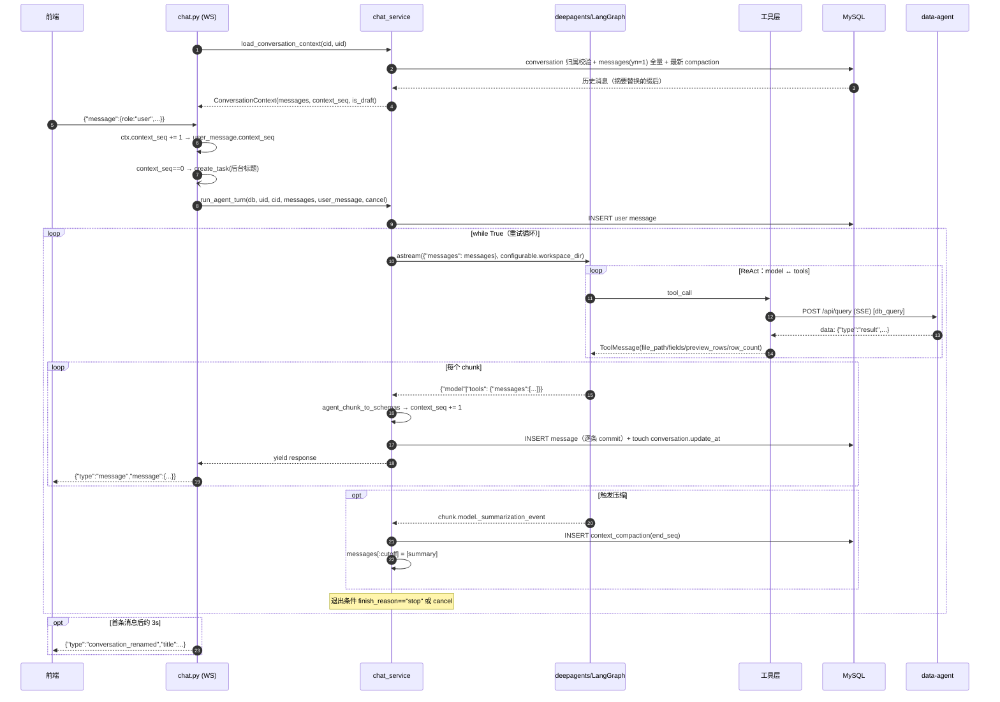

# insight-agent 系统架构与主要流程（现状梳理 · 升级改造基线）

> **范围**：`G:\tearcher_code\insight\insight-agent`（归因分析子项目）
> **依据**：仓库源码逐文件核对（`app/` 全部 40 个 Python 文件、`configs/`、`sql/`、`.deepagents/`、`web/src/`）+ 本地 `deepagents 0.4.7` 安装源码
> **生成时间**：2026-10-07
> **与既有文档的关系**：`AGENT_ARCHITECTURE.md` 只聚焦「Agent 层 + 单轮调用链路」；本文是**子项目全量视角**（定位 / 分层 / 接口 / 数据 / 全部主要流程 / 改造切入点），两者互补，不重复。

---

## 0. 结论速览（先看这一页）

| 维度 | 事实 |
|---|---|
| 定位 | 面向电商业务的**对话式归因分析服务**：自然语言提问 → 自主取数 → 多维拆解 → 产出 HTML 报告 |
| 技术栈 | Python ≥3.12 · FastAPI（HTTP + WebSocket）· deepagents 0.4.7 → LangGraph · LangChain · SQLAlchemy 2.x(asyncmy) · MySQL 8 · Redis 7 · uv |
| 进程模型 | **单进程 uvicorn**（端口 7300）；Agent 为**进程内全局单例**；**无 checkpointer / 无 LangGraph store** |
| 状态托管 | 会话状态全部自管：`message`（全量）+ `context_compaction`（摘要）落 MySQL，每轮从 DB 重建上下文 |
| 入口 | HTTP：`/api/chat/*`、`/api/chat/attachment/*`、`/api/reload`；WebSocket：`/api/chat/ws/chat` |
| 鉴权 | HTTP 走 auth 服务 introspection（OAuth2 Bearer）；**WebSocket 走 Redis 一次性令牌（GETDEL，TTL 30s）**，不走 introspection |
| 工具面 | 内置 9（文件/搜索/execute/task/todos）+ 本地 2（`db_query` / `return_file`）+ MCP（tavily） |
| 唯一取数通道 | `db_query` → HTTP SSE `POST {data-agent}/api/query`；**禁止直接连 MySQL** |
| 交付物 | 工作区文件 → `return_file` 声明 → 前端经 `/api/chat/attachment/get` 下载；HTML 由 Skill 脚本 `render_report.py` 生成 |
| 上下文压缩 | deepagents `SummarizationMiddleware`，阈值 = 0.85 × 1,048,576 ≈ **891k tokens**（实际几乎不触发） |
| 前端 | React 19 + Vite 7 + TS + Tailwind 3 + Zustand + axios；构建产物由后端 `app/static/dist` 托管（SPA 回退） |
| 最大改造接缝 | `db_query`（取数契约）/ `_backend_factory`（工作区与后端） / `chat_service.run_agent_turn`（单轮编排）/ `SKILL.md`（方法论）四处 |

---

## 1. 定位与边界

### 1.1 在整体智能问数项目中的位置

```
┌──────────────── B 端商家 / 运营 ────────────────┐
│  "GMV 为什么跌了？"  "上个月 GMV 多少？"         │
└───────────────────┬─────────────────────────────┘
                    │ WebSocket / HTTP
┌───────────────────▼─────────────────────────────┐
│  insight-agent（本子项目 · 归因分析）             │
│  · deepagents Agent + insight Skill（方法论）    │
│  · 会话状态自管（MySQL）+ 工作区（文件系统）      │
│  · 工具链：db_query / return_file / MCP          │
└───────┬──────────────────────┬──────────────────┘
        │ SSE NL2SQL           │ OAuth2 introspection
┌───────▼──────────┐   ┌───────▼──────────┐
│ data-agent       │   │ auth             │
│ NL2SQL + 元数据   │   │ OAuth2 + PKCE    │
└───────┬──────────┘   └──────────────────┘
        │ SQL
┌───────▼─────────────────────────────────────────┐
│ dbmock  5 层电商数仓（MySQL 8 + Redis）          │
└─────────────────────────────────────────────────┘
```

### 1.2 职责边界

**做**：

- 对话式归因分析编排（理解 → 取数 → 拆解 → 异常识别 → 报告）
- 会话生命周期管理（创建/列表/改名/删除/历史消息）
- 工作区文件管理（会话隔离的 raw / analysis / outputs）
- 流式输出与协作式取消
- 交付物（HTML 报告等）到前端的回传

**不做**（依赖外部）：

| 能力 | 归属 |
|---|---|
| 自然语言 → SQL、Schema/元数据召回、SQL 校验 | `data-agent` |
| 身份认证、令牌签发与内省 | `auth` |
| 业务数据生成与数仓结构 | `dbmock` |
| 报告 HTML 的模板渲染（脚本级） | 本项目 Skill 目录内脚本，但语义由 `SKILL.md` 约束 |

### 1.3 对外依赖契约（改造时必须冻结的部分）

| 依赖 | 协议 | 地址/端点 | 源码位置 |
|---|---|---|---|
| data-agent | HTTP SSE（`text/event-stream`） | `{base_url}/api/query`；本地 `http://localhost:8000` | `configs/config.yml:64-67`、`app/agent/tools/db_query.py:16,36-61` |
| data-agent 返回体 | SSE 帧 `data: {"type":"result","data":...}` / `{"type":"error",...}` | — | `db_query.py:45-61,153-170` |
| auth | HTTP POST introspection | `{base_url}/api/introspection`；本地 `http://localhost:7100` | `config.yml:59-62`、`app/core/middlewares/auth.py:27-30` |
| MySQL | asyncmy（`mysql+asyncmy`） | `configs/.env` 注入 | `app/core/database.py:71-77` |
| Redis | redis-py asyncio | 本地 `127.0.0.1:6379` | `config.yml:12-17`、`app/core/redis.py` |
| LLM | OpenAI 兼容协议 | `https://api.deepseek.com/v1`，模型 `deepseek-v4-flash` | `config.yml:24-34`、`app/agent/agent.py:56-66` |
| MCP | streamable_http | `https://mcp.tavily.com/mcp/` | `config.yml:53-57`、`app/agent/mcp.py` |

> ⚠️ `db_query` 请求体除 `query` 外还会带 `conversation_id`（供 data-agent 按会话分文件记日志），这是**已生效的隐式契约**（`db_query.py:33-35`）。

---

## 2. 技术栈与运行时

### 2.1 依赖清单（`pyproject.toml`）

| 类别 | 依赖 | 用途 |
|---|---|---|
| Web | `fastapi[standard]>=0.135.1` | HTTP + WebSocket + 依赖注入 + uvicorn |
| Agent | `deepagents>=0.4.7` | Agent 编排、中间件栈、工作区后端 |
| LLM | `langchain-openai`、`openai>=2.16` | ChatModel 适配 |
| MCP | `langchain-mcp-adapters>=0.2.1` | `MultiServerMCPClient` |
| ORM/DB | `sqlalchemy[asyncmy]>=2.0.46`、`asyncmy`、`pymysql` | 异步 ORM；pymysql 供同步场景（init_db 反射） |
| 缓存 | `redis>=7.2` | WS 令牌 |
| 配置 | `omegaconf`（+ 传递依赖 `python-dotenv`，未显式声明） | yml + .env，支持 `${oc.env:...}` 插值 |
| 数据处理 | `pandas>=3.0.1` | 工作区分析（Skill 要求） |
| 文档解析 | `pdfplumber`、`pypdf` | 附件/RAG 场景 |
| 日志 | `loguru>=0.7.3` | 彩色控制台 + JSONL 文件 |
| 代码生成 | `sqlacodegen>=3.2` | 从 DB 反射生成 ORM 实体 |
| dev | `ruff`、`pyright` | 格式化/lint/类型检查 |

### 2.2 运行时形态

- **单进程**：`uvicorn.run("app.main:app", host="0.0.0.0", port=cfg.port)`（`app/main.py:83-84`），端口 `7300`
- **无状态化程度**：DB/Redis 外置，但 **Agent 单例与工作区在本地磁盘**——多实例部署时工作区不共享（见 §9 改造点）
- **启动动作**：`lifespan` 中 `setup_logger()` → `init_database()`（仅当库不存在时建库 + 执行 DDL + sqlacodegen 生成 ORM）；关闭时依次释放 http client / redis / db
- **配置加载**：`configs/config.yml` + `configs/.env`，OmegaConf `resolve=True` → Pydantic 校验（`app/core/settings.py`）；模块级 `cfg` 单例，`reload_config()` 可热更

### 2.3 中间件与横切

| 顺序（外→内） | 中间件 | 行为 |
|---|---|---|
| 1 | CORS | `allow_origins=cfg.cors_origins`（默认空）、`allow_credentials=True`、全方法全头 |
| 2 | trace | 生成/透传 `X-Request-ID`、`X-Trace-ID`，注入 `request_id/trace_id/client_ip/method/path` 至 ContextVar，回写响应头 |
| 3 | auth | **仅拦截路径以 `/api` 开头**的 HTTP 请求；调 auth introspection，`active=false` 报错；成功把 `payload` 写入 `request.state.payload`、`user_id` 注入 ContextVar |

> 📌 注册顺序为 auth → trace → CORS，Starlette 的 middleware 栈是「后注册者在外层」，因此实际执行顺序为 **CORS → trace → auth**。
> 📌 `app.middleware("http")` 只覆盖 HTTP scope，**WebSocket 不经过 auth introspection**，鉴权完全由一次性令牌承担（见 §6.2）。

**异常处理**：4 个全局处理器（`app/core/exceptions/exc_handlers.py`）——`ProblemError`（RFC 9457，`application/problem+json`）、`RequestValidationError`、`HTTPException`、兜底 `Exception`。业务异常定义在 `app/errors/`（auth/chat/attachment 三组）。

**可观测**：`loguru` 输出彩色控制台 + `logs/YYYY-MM-DD.jsonl`（单文件上限 `log.max_file_size`，默认 100MB）。

---

## 3. 代码结构与分层

```
insight-agent/
├── app/
│   ├── main.py                      # FastAPI 装配（lifespan / 中间件 / 异常 / 路由）
│   ├── init_db.py                   # 建库 + 执行 sql + sqlacodegen 生成 ORM
│   ├── plugins/lifespan/init_database.py   # 启动时按需初始化数据库
│   │
│   ├── core/                        # 基础设施（横切）
│   │   ├── settings.py              # .env + config.yml → cfg；reload_config()
│   │   ├── database.py              # DatabaseManager（多库引擎/会话）· get_db / get_db_session
│   │   ├── redis.py                 # Redis 异步单例（ping 探活，断连重建）
│   │   ├── http_client.py           # httpx.AsyncClient 单例（timeout 300s，100 连接池）
│   │   ├── context.py               # ContextVar：request_id/trace_id/client_ip/method/path/user_id
│   │   ├── log_setup.py             # loguru 彩色 + JSONL
│   │   ├── middlewares/{auth,trace}.py
│   │   └── exceptions/{base,exc_handlers}.py
│   │
│   ├── entities/chat.py             # ORM：Conversation / Message / ContextCompaction
│   ├── schemas/{chat_schema,auth_schema}.py   # Pydantic 前后端契约
│   ├── repositories/                # 数据访问：conversation / message / context_compaction / websocket_token
│   ├── mappers/message_mapper.py    # 三向消息转换（Entity ↔ Schema ↔ LangChain）
│   │
│   ├── services/chat_service.py     # ★ 单轮编排：装载上下文 / 执行 / 压缩 / 重试 / 标题
│   ├── agent/                       # ★ Agent 核心
│   │   ├── agent.py                 # 工作区、后端工厂、Agent 构建与单例
│   │   ├── mcp.py                   # MultiServerMCPClient 装配
│   │   └── tools/{db_query,return_file}.py
│   ├── routers/
│   │   ├── api/chat.py              # ★ 对话/消息/WS/令牌 + _TurnStream
│   │   ├── api/attachment.py        # 工作区附件上传/下载/删除
│   │   ├── api/admin.py             # POST /api/reload
│   │   └── frontend.py              # 静态资源 + SPA 回退 + /auth-api 反代
│   ├── errors/{auth,chat,attachment}_error.py
│   └── static/dist/                 # 前端构建产物（由 web/ 构建后拷入）
│
├── .deepagents/
│   ├── skills/
│   │   ├── insight/                 # ★ 归因方法论：SKILL.md(16KB) + scripts/render_report.py(24KB)
│   │   └── {docx,pdf,pptx,xlsx}/    # 通用文档技能（含各自 scripts/，各占 1 个 skill 名额）
│   └── workspaces/user_{uid}/{cid}/ # 会话工作区（raw / analysis / outputs，懒创建）
│
├── configs/{config.yml, .env}
├── sql/mysql/chat.sql               # 3 张表 DDL
├── docker/docker-compose.yaml       # 仅 MySQL + Redis
├── logs/YYYY-MM-DD.jsonl
├── web/                             # React 前端（独立 npm 工程）
└── 既有文档：DOC.md / AGENT_ARCHITECTURE.md / QUICKSTART.md / change.md / README.md
```

### 分层调用约束（实际遵守情况）

```
routers/api/*        ← HTTP/WS 接入、参数校验、鉴权后上下文取用
     ↓
services/*           ← 业务编排（本轮唯一 service：chat_service）
     ↓                    ↓
repositories/*       agent/*  ← 数据访问 / Agent 组装与工具
     ↓                    ↓
entities/*（ORM）    deepagents 运行时 → 工作区文件系统 / 外部服务
```

- 依赖方向单向，无循环引用
- `mappers/` 与 `schemas/` 是横切契约层，被 router / service / mapper 内部互调
- **缺口**：`routers/api/chat.py` 内含编排逻辑（令牌校验、`_TurnStream`、标题旁路、草稿转换），部分职责本应下沉到 service 层

---

## 4. 核心组件详解

### 4.1 Agent 装配（`app/agent/agent.py`）

```
_build_agent()
  ├─ 读 cfg.lm_config.models[active] → init_chat_model(provider="openai", request_timeout=180, max_retries=2)
  ├─ mcp_tools = await get_mcp_tools()          ← 任一 MCP 不可达则整体构建失败
  ├─ tools = [db_query, return_file, *mcp_tools]
  ├─ system_prompt = 中文业务约束（人设 / 专业客观 / 任务执行 / 工具优先级 / 常见错误 / 文件读取 / 进度同步）
  └─ create_deep_agent(model, tools, system_prompt, backend=_backend_factory, skills=["/skills/"])
```

关键点：

- **中文 system_prompt 在前，deepagents 的英文 `BASE_AGENT_PROMPT` 由框架追加在后**——中文占主导，英文保留工具调用等基础行为约束（`agent.py:72-121` 注释明确此意图）
- system_prompt 里有若干**硬指令**，是当前架构的事实约束：
  - 取数**只能**走 `db_query`，禁止直接 exec python 连 MySQL
  - 读 `SKILL.md` 必须 `read_file(path="/skills/insight/SKILL.md", limit=2000)`（默认 limit=100 会丢后半段）
  - Python 一律 `uv run`，禁止 `pip install`
  - 禁止 `echo "..." > file.py` 写长代码，禁止在 `python -c` 里写超过 5 行
- **单例**：`_agent` 全局变量 + `asyncio.Lock` 双检锁；`reset_agent()` 置空供配置热更（`agent.py:135-150`）

### 4.2 工作区与文件系统后端

```
每会话差异通过「运行时配置」注入，而不是重建 Agent：

_execute_agent:  RunnableConfig(configurable={"workspace_dir": str(workspace)})
                                    ↓ get_config()["configurable"]["workspace_dir"]
_backend_factory(rt):
  workspace_backend = LocalShellBackend(root_dir=workspace_dir, virtual_mode=True, inherit_env=True)
  skills_backend    = FilesystemBackend(root_dir=.deepagents/skills, virtual_mode=True)
  return CompositeBackend(default=workspace_backend, routes={"/skills/": skills_backend})
```

| 路径 | 落点 | 能力 |
|---|---|---|
| 默认（无前缀） | `LocalShellBackend` → 会话工作区 | 文件读写 + `execute`（**宿主机真实 shell**） |
| `/skills/` | `FilesystemBackend` → `.deepagents/skills` | 只读式读技能文件（`/skills/insight/SKILL.md`） |

- 工作区目录：`.deepagents/workspaces/user_{user_id}/{conversation_id}/`，`get_workspace_dir()` 每次调用 `mkdir(parents=True, exist_ok=True)` **懒创建**
- 目录约定 `raw/` / `analysis/` / `outputs/` 来自 `SKILL.md`，**是软约定，代码不强制**
- `return_file` / `db_query` 都从 `runtime.config["configurable"]["workspace_dir"]` 取基准路径，与文件系统**共享同一份会话上下文**，无需全局状态

### 4.3 工具面全景

| 来源 | 工具 | 说明 |
|---|---|---|
| Filesystem 中间件 | `ls` `read_file` `write_file` `edit_file` `glob` `grep` `execute` | `execute` 依赖后端实现 `SandboxBackendProtocol`，`LocalShellBackend` 满足 |
| SubAgent | `task` | 通用子 Agent，携带同一套工具与中间件 |
| TodoList | `write_todos` | 长任务拆解 |
| 本地（`app/agent/tools/`） | `db_query` | **唯一合规取数通道**（SSE → 落盘 → 返回摘要） |
| 本地 | `return_file` | 交付物声明为附件（只做路径校验，不传字节） |
| MCP | `tavily_search` 等 | `MultiServerMCPClient`，`transport` 字符串映射 4 种连接类型 |

**`db_query` 产出契约**（`db_query.py:212-227`）：

```json
{
  "status": "success",
  "file_path": "<abs>/raw/xxx.csv",
  "file_format": "csv",
  "pandas_read_hint": "pd.read_csv('...')",
  "fields": ["...列名..."],
  "preview_rows": [ ...前 5 行... ],
  "row_count": 1234
}
```

设计意图：**大结果集不进上下文**——全量落盘，模型只看 `preview_rows`（5 行）+ 列名 + 行数，后续用 pandas 从文件读。

**`return_file` 产出契约**（`return_file.py:32-41`）：`{status, message, f_path, f_name}`；`f_path` 前导 `/` 会被归一化，路径逃逸与文件不存在均返回 error。

### 4.4 消息适配层（`app/mappers/message_mapper.py`，328 行）

三种形态，四个转换函数 + 一个流式入口：

| 层 | 形态 | 函数 |
|---|---|---|
| 存储 | `message.parts` / `attachments` 两个 **JSON 字符串** | `schema_to_entity` / `entity_to_schema` |
| 前后端 | `MessageSchema`（`parts[]` 判别联合：`text` / `image_url` / `tool_call` / `tool_result`） | —— |
| 运行时 | LangChain `AIMessage` / `ChatMessage` / `ToolMessage`；或 `{"role":...,"content":[...]}` dict | `langchain_message_to_schema` / `schema_to_langchain_message` |
| 流式入口 | `agent_chunk_to_schemas(chunk)` | 遍历 `chunk["model"|"tools"].messages` |

**两个隐形语义**：

1. **`return_file` → 附件**：ToolMessage 的 `name == "return_file"` 且 payload `status == "success"` 时，`f_path` 被提升为 `MessageSchema.attachments`（`message_mapper.py:141-153`）——工具本身不传字节。
2. **附件进模型的方式**（`_process_attachments`）：
   - 文档 → 在 prompt 里追加文本「用户上传的以下文件已保存到当前工作区，可直接读取：`- 文件：X`」
   - 图片 → 从工作区读字节 → base64 data URL 塞进 `content`（**无大小/数量限制**）

### 4.5 状态与持久化

| 存储 | 内容 | 关键机制 |
|---|---|---|
| MySQL `conversation` | 会话元信息 | `yn=0` 逻辑删除；`is_draft` 草稿态 |
| MySQL `message` | 全量消息（含 tool 调用与结果） | `UNIQUE(conversation_id, context_seq)`；每条落库一次 commit |
| MySQL `context_compaction` | 压缩事件（摘要 + 覆盖范围） | 取 `end_seq DESC, id DESC` 最新一条 |
| Redis `ws_token:{token}` | WS 连接令牌 → `{user_id}` | `setex` 30s TTL；`GETDEL` 一次性消费 |
| 本地磁盘 | 会话工作区文件 | 删会话时 `shutil.rmtree` |

**没有的东西**（改造时要注意）：无 LangGraph checkpointer、无 LangGraph store、无用户画像/偏好记忆（deepagents 的 MemoryMiddleware 未启用）、无向量检索。

### 4.6 Skill 体系

| Skill | 内容 | 注入方式 |
|---|---|---|
| `insight` | 归因方法论 + 电商数仓字段硬约束 + 退款归因专题 + pandas/uv 规则 + HTML/图表要求 + `scripts/render_report.py` | frontmatter（name+description）进 system prompt 技能列表；全文由 Agent 按需 `read_file` |
| `docx` / `pdf` / `pptx` / `xlsx` | 通用文档处理（各带 `scripts/`） | 同上 |

- **`insight/SKILL.md`（16KB，342 行）是方法论的事实载体**，内容包含：
  - 进入归因模式的条件（"为什么"/"谁贡献"/"复盘"/"输出报告"…）
  - **字段硬约束表**：`refund_status` 中文枚举、`pay_status` 只在支付表、金额单位为**分**（必须 `*0.01`）、`order_pay_time` 而非 `pay_time`、省码 6 位 vs 维表 12 位必须配 `region_level=1` 等
  - 三条「数据获取铁律」+ 三步「数据对账」
  - 退款归因标准工作流（4 Step）
  - 默认分析维度（≥4 维，经营诊断建议 ≥6 维）与常用交叉
  - 图表与 HTML 报告的 block 规范
- `render_report.py`：读 `analysis/report_payload.json` → 输出自包含 HTML；支持 block 类型 `section / prose / list / metrics / cards / table / echarts / bar-chart / line-chart / ranking / callout / columns`

---

## 5. 接口清单

### 5.1 HTTP

| 方法 | 路径 | 鉴权 | 职责 | 源码 |
|---|---|---|---|---|
| POST | `/api/chat/create` | Bearer | 建会话（`title="新对话"`，可选 `is_draft=1`），201 | `chat.py:37-60` |
| POST | `/api/chat/delete` | Bearer | 批量逻辑删会话 + 消息 + 压缩记录 + 递归删工作区 | `chat.py:63-94` |
| POST | `/api/chat/update` | Bearer | 改标题 | `chat.py:97-113` |
| GET | `/api/chat/ls` | Bearer | 当前用户会话列表（`is_draft=0`、`yn=1`，按 `update_at DESC, id DESC`） | `chat.py:116-133` |
| GET | `/api/chat/ls/{conversation_id}` | Bearer | 某会话全部消息（按 `context_seq ASC, id ASC`）**注：未校验归属** | `chat.py:136-145` |
| POST | `/api/chat/ws-token` | Bearer | 签发 WS 一次性令牌（32 字节 urlsafe，TTL 30s） | `chat.py:148-173` |
| POST | `/api/chat/attachment/upload` | Bearer | multipart 分块（1MB）落工作区，防路径逃逸 | `attachment.py:27-55` |
| POST | `/api/chat/attachment/delete` | Bearer | 删工作区文件 | `attachment.py:58-82` |
| GET | `/api/chat/attachment/get` | Bearer | 下载工作区文件（`FileResponse`，按扩展名猜 MIME） | `attachment.py:85-116` |
| POST | `/api/reload` | Bearer | `reload_config()` + `reset_agent()` | `admin.py:9-14` |
| ANY | `/auth-api/{path}` | 无 | 反代到 auth 服务（浏览器直连 auth 的桥） | `frontend.py:35-79` |
| GET | `/{full_path}` | 无 | SPA 回退；`/api` `/auth-api` `/assets` `/docs` `/openapi.json` `/redoc` 前缀除外 | `frontend.py:82-96` |
| GET | `/assets/*` | 无 | 前端静态资源（`app/static/dist/assets`） | `frontend.py:99-107` |

> 所有 `/api/*` 都经 auth 中间件校验 Bearer Token（`Authorization` → auth introspection）。

### 5.2 WebSocket 协议（`/api/chat/ws/chat?conversation_id=&websocket_token=`）

**上行（客户端 → 服务端）**

| 报文 | 语义 |
|---|---|
| `{"message": MessageSchema}`（`role` 必须为 `user`） | 发起一轮对话 |
| `{"type": "cancel"}` | 请求中断当前轮 |

**下行（服务端 → 客户端）**

| 报文 | 语义 |
|---|---|
| `{"type":"message","message":MessageSchema}` | 流式消息（assistant 文本/tool_call、tool 结果、return_file 附件） |
| `{"type":"error","content":"..."}` | 错误（请求格式非法 / 模型调用失败 / 会话不存在） |
| `{"type":"conversation_renamed","conversation_id":N,"title":"..."}` | 后台标题生成完成（非主链） |

**关闭码**：`4401` 缺令牌或令牌无效/已消费；`4404` 会话不存在或不属于当前用户。

---

## 6. 主要流程

### 6.1 服务启动

```
uv run -m app.main
 └─ create_app()
     ├─ register_middlewares: CORS → trace → auth（注册逆序）
     ├─ register_exception_handlers: ProblemError / ValidationError / HTTPException / Exception
     ├─ register_routers: /api/chat · /api/chat/attachment · /api · 前端(静态+回退+反代)
     └─ lifespan 启动段
         ├─ setup_logger()（控制台 + logs/YYYY-MM-DD.jsonl）
         └─ init_database()：prepare() → 逐一 check_db_exists → 不存在才 init_db（建库 + 执行 sql + sqlacodegen 生成 ORM）
```

> Agent **不在启动时构建**，首次 WS 消息触发 `get_agent()` 懒构建（`reset_agent()` 后同理）。

### 6.2 建会话 → 取令牌 → 建连（Phase 1）

```
① POST /api/chat/create              → conversation(id=N, title="新对话", is_draft)
② POST /api/chat/ws-token            → Redis SETEX ws_token:{token} 30s → 返回 token
③ WS /api/chat/ws/chat?conversation_id=N&websocket_token=...
     _validate_and_accept()
       ├─ 缺 token            → close(4401)
       ├─ Redis GETDEL 取不到 → close(4401)          ← 一次性消费，不可重放
       ├─ context.user_id_ctx.set(user_id)
       └─ websocket.accept()
```

**为什么 WS 不走 introspection**：浏览器 WebSocket API 无法自定义 `Authorization` 头，因此设计为「HTTP 换一次性令牌 → WS 用 query 参数带令牌 → `GETDEL` 原子消费」。这是当前唯一的 WS 鉴权链路，也是**多实例部署的约束点**（令牌在 Redis，天然可跨实例；但 Agent 与工作区在本地）。

### 6.3 单轮对话主流程（Phase 2 + Phase 3，核心）



**逐步说明**：

| 步 | 位置 | 行为 |
|---|---|---|
| 1 | `chat.py:320` | `load_conversation_context`；会话不存在/不属于当前用户 → 推 error + `close(4404)` |
| 2 | `chat.py:335-337` | `_receive_user_message`：`{"type":"cancel"}` 直接丢弃；Pydantic 校验失败推 error；`role != "user"` 推 error |
| 3 | `chat.py:340-341` | `ctx.context_seq += 1` → 写入 `user_message.context_seq`（**首条为 0**） |
| 4 | `chat.py:346-363` | `context_seq == 0` 且有文本 → `create_task(_background_title_and_notify)`，**不阻塞主链** |
| 5 | `chat.py:366-369` | `is_draft` → 转正式（`is_draft=0`） |
| 6 | `chat.py:371` | `async with _TurnStream(...)`：启动独立 cancel 监听 task |
| 7 | `chat_service.py:162` | 用户消息**先落库**（失败也留痕，见 §9 风险 8） |
| 8 | `chat_service.py:167-210` | `while True` 单轮主循环：`seq_offset` 重算 → `astream` → 逐 chunk 转换/落库/推送 → 压缩落库 → 退出判定 |
| 9 | `chat.py:385-388` | 异常兜底：`send_error("模型调用失败，请稍后重试。")`，**不关连接**，回到步骤 2 等下一条 |
| 10 | `chat.py:390-391` | `stream.disconnected` → break，结束 WS 会话 |

**`seq_offset` 是什么**：`seq_offset = cur_context_seq - len(messages) + 1`，把「内存 `messages` 下标」翻译成「DB `context_seq`」的唯一桥梁。压缩发生后数组下标会变，但 `context_seq` 单调递增不回退，前端第 N 条永远能精确定位到 DB 同一行。

### 6.4 取数流程（`db_query`，唯一合规通道）

```
Agent 调 db_query(query="最近3个月退款金额按月分布", file_name="refund_by_month")
  ↓ 从 runtime.config.configurable.workspace_dir 取基准路径
  ↓ 从 workspace_dir.name 反推 conversation_id（int(dirname)，失败则 None）
  ↓ POST {data-agent}/api/query   body={"query":..., "conversation_id":...}   accept: text/event-stream
  ↓ 逐行解析 SSE：只处理 "data:" 前缀 → json.loads（解析失败产出 error chunk 而不中断流）
  ↓ 收集 type=="result" 的 data；type=="error" 立即返回 {"status":"error", "message":...}
  ↓ 结果分类：
       list[dict]（含空列表）→ 写 {file_name}.csv（列名取所有行 key 的并集，按首现顺序）
       其他                  → 写 {file_name}.json（ensure_ascii=False, default=str）
  ↓ 返回 {status, file_path, file_format, pandas_read_hint, fields, preview_rows[:5], row_count}
```

要点：

- **落盘位置是工作区根目录**（`workspace_dir / f"{file_name}.csv"`），不是 `raw/` 子目录——`raw/` 只是 SKILL.md 的软约定
- 空列表被判定为合法表格（`_as_tabular_rows` 返回 `[]`）→ 落空 CSV，不报错
- `error` chunk 的处理是 2026-06-08 补的修复（此前会被忽略，最终落到 "finished without result"）
- 大表保护、元数据召回、字段别名能力**都在 data-agent 侧**，本项目只做通道

### 6.5 报告交付流程

```
Agent 分析完毕（工作区 analysis/report_payload.json）
  ↓ uv run python /skills/insight/scripts/render_report.py --input analysis/report_payload.json --output outputs/xxx.html
  ↓ 生成自包含 HTML（内嵌 ECharts）
  ↓ 调 return_file(f_path="outputs/xxx.html")            ← 只做路径校验 + 声明
  ↓ ToolMessage(name="return_file", content={"status":"success","f_path":...,"f_name":...})
  ↓ message_mapper 识别 → MessageSchema.attachments=[Attachment(f_path=...)]  ← 关键适配
  ↓ WS 推 {"type":"message","message":{role:"tool", attachments:[...]}}
  ↓ 前端渲染附件卡片 → GET /api/chat/attachment/get?conversation_id=&f_path= → FileResponse
```

### 6.6 上下文压缩流程（L2）

| 关 | 行为 |
|---|---|
| 触发 | `profile.max_input_tokens = 1048576` → `trigger=("fraction", 0.85)`、`keep=("fraction", 0.10)` ⇒ 约 **891k tokens** |
| 压缩（框架内） | offload 历史到后端文件 → LLM 生成摘要 → 覆写本次请求为 `[summary, ...保留尾部]` → 回传 `_summarization_event{cutoff_index, summary_message, file_path}` |
| 落地（本项目） | `_extract_compaction` 从 chunk 取事件 → `ContextCompaction(end_seq = seq_offset + cutoff_index)` 落 `context_compaction` → 本轮结束后 `messages[:cutoff_index] = [{"role":"user","content":summary}]` |
| 恢复 | 下一轮 `load_conversation_context` 取最新 compaction → `messages[:end_seq] = [summary]` |

**编号对齐**（最容易读错的地方）：

| 编号 | 语义 | 换算 |
|---|---|---|
| `context_seq` | DB 会话级序号，0 起，唯一 | 每条落库 `+1` |
| `messages` 索引 `i` | 内存列表下标（含摘要占位） | `context_seq = seq_offset + i` |
| `cutoff_index` | 框架给出的截断位置（相对本次请求） | `end_seq = seq_offset + cutoff_index` |

### 6.7 取消流程（协作式）

```
前端点"停止" → WS 发 {"type":"cancel"}
  ↓ _TurnStream._listen_cancel() 收到 → self.cancel.set()          （独立 task，与 Agent 并行）
  ↓ run_agent_turn 在 async for chunk 循环顶部检测 cancel.is_set()
  ↓ break → 本轮退出；已落库的 message 保留，未产生的丢弃
  ↓ 外层 if last_finish_reason=="stop" or cancel.is_set(): break
```

**为什么不用 `Task.cancel()`**：调用栈是 `astream` → LangGraph 状态机 → 中间件链 → LLM，强杀会在任意位置注入 `CancelledError`，可能留下半提交状态。代价是**非抢占式**——若模型/工具长时间不产出 chunk，取消会延后生效（最高延迟 ≈ 1 个 chunk）。

**断连兜底**：`_TurnStream.send()` 捕获 `WebSocketDisconnect` 时同时置 `disconnected=True` 与 `cancel.set()`；`send_error()` 只置 `disconnected`。

### 6.8 会话标题旁路

```
首条消息（context_seq==0）→ asyncio.create_task(_background_title_and_notify)
  → await asyncio.sleep(3)                       # 让首条回复先出
  → _get_title_llm()（独立 LLM 实例，timeout=30，max_retries=1，双检锁单例）
  → generate_conversation_title()：中文 prompt，要求 5~10 汉字，去引号，>30 字截断
  → generate_and_save_title_background()：
       独立 DB session（主流程 session 可能已关）→ 校验归属 → **仅当 title 仍为"新对话"才更新**
  → WS 推 {"type":"conversation_renamed", conversation_id, title}
失败静默：超时/异常只打 warning，不影响主链
```

### 6.9 附件流程

| 动作 | 链路 |
|---|---|
| 上传 | `POST /api/chat/attachment/upload` → 归属校验 → `_build_attachment_path` 防逃逸 → 1MB 分块落工作区 → 返回 `Attachment(f_path=原文件名)` |
| 进模型 | 下一轮 `schema_to_langchain_message` → `_process_attachments`：文档加 prompt 提示 / 图片转 base64 data URL |
| 产出文件 | `return_file` → `attachments` → 前端 GET 下载 |

> 上传落点与 `db_query` 落点同为**工作区根目录**，靠 `f_path` 区分；图片 data URL 无大小上限。

### 6.10 删除会话

```
POST /api/chat/delete {conversation_ids:[...]}
  逐条：归属校验（不符 → ConversationNotFoundError）
       → conversation.yn=0
       → message.yn=0（按 conversation_id 批量）
       → context_compaction.yn=0（按 conversation_id 批量）
       → asyncio.to_thread(shutil.rmtree, workspace_dir, ignore_errors=True)
```

DB 层**无物理删除**（`ON DELETE CASCADE` 只是兜底 DDL 约束）；工作区**物理删除**且不可恢复。

### 6.11 配置热更新

```
POST /api/reload
  → reload_config()      # 重读 configs/.env + config.yml，替换模块级 cfg
  → reset_agent()        # 置空 Agent 单例（asyncio.Lock 保护）
  → 下次请求 get_agent() 重新 _build_agent() → 重新扫 skills/ 目录、重连 MCP
```

**两阶段顺序**：先 reload 成功再 reset，避免用半新半旧配置构建 Agent。**SKILL.md 的改动也走这条路径生效**（`FilesystemBackend` 每次读都是新 IO，但 Agent 的技能列表在构建时注入 prompt，因此需要 reset 才能刷新 frontmatter）。

---

## 7. 数据模型

`sql/mysql/chat.sql`（库名由 `configs/.env: DB_NAME` 决定）：

| 表 | 字段 | 约束/索引 |
|---|---|---|
| `conversation` | `id`(PK) · `user_id` · `title`(128) · `is_draft`(tinyint) · `create_at` · `update_at` · `yn`(tinyint) | `INDEX(user_id)` |
| `message` | `id`(PK) · `conversation_id` · `context_seq` · `role`(10) · `parts`(MEDIUMTEXT, JSON) · `finish_reason`(128) · `attachments`(TEXT, JSON) · `create_at` · `yn` | FK→conversation ON DELETE CASCADE · `INDEX(conversation_id)` · **`UNIQUE(conversation_id, context_seq)`** |
| `context_compaction` | `id`(PK) · `conversation_id` · `end_seq` · `summary_message`(MEDIUMTEXT) · `create_at` · `yn` | FK→conversation ON DELETE CASCADE · `INDEX(conversation_id)` · `INDEX(conversation_id, end_seq)` |

DDL 头部会 `SET GLOBAL/SESSION time_zone = '+08:00'`。

**`context_seq` 语义（易误判）**：空会话 `cur_context_seq = -1`，首条消息 `+=1` ⇒ **从 0 开始**递增（不是从 1）。一轮里 assistant / tool 消息也都各占一个序号。

**ORM 来源**：`entities/chat.py` 由 `sqlacodegen` 从实际库反射生成（`app/init_db.py`），因此**改表结构必须重新生成实体**，不要手改。

---

## 8. 前端架构（`web/`）

| 维度 | 实现 |
|---|---|
| 技术栈 | React 19 · Vite 7 · TypeScript 5.9 · Tailwind 3 · Zustand 5 · axios · react-markdown + remark-gfm · Radix Slot/Separator · sonner · Biome |
| 路由 | `/` → 重定向 `/chat`；`/chat`、`/chat/:conversationId`（`ProtectedRoute` 包裹）；`/auth/callback`；`*` → NotFound（懒加载） |
| 鉴权 | OAuth2 + PKCE（`web/src/auth/`：`authorize / oauth / token / store / guards`）；`CLIENT_ID="insight-agent"`；access token 存 localStorage（key `insight-agent:access-token`）；`/auth-api/*` 由后端反代到 auth 服务 |
| 状态 | Zustand `chatStore`（会话列表、消息、`updateConversationTitle`、`renameConversation` 乐观更新+回滚） |
| 通信 | axios 封装（`api/appClient.ts`）+ WS 客户端（`api/chat.ts`）；`ws-token` → 建 WS → `onmessage` 按 `type` 分发（`message` / `error` / `conversation_renamed`） |
| 页面 | `pages/Chat/index.tsx` + 组件 `ChatSidebar` / `ChatMessages`（含 `ThinkingIndicator` 脉冲动效） / `ChatComposer` / `ConversationTitleItem` |
| 构建产物 | `vite build` 后需落到 `app/static/dist/`，由后端 `frontend.py` 托管（`/assets` 挂载 + SPA 回退） |
| 开发端口 | dev server `7301`，代理 `/api` → `localhost:7300`，`/auth-api` → `localhost:7100` |

**已知的前端生命周期约定**：WS 采用「页面卸载才关闭」策略，idle 超时 30 分钟；会话切换/Agent 结束都不断 socket（`change.md:128-148`）。

---

## 9. 现状评估与升级改造切入点

### 9.1 架构层面最值得注意的三点

1. **「框架做执行、自己做状态」**：deepagents 只管单次 `astream` 内的中间件链与 ReAct 循环；会话历史与压缩摘要由 `chat_service` 每轮从 MySQL 重建。好处是不依赖框架 checkpointer、进程崩溃不丢数据；代价是**每轮都要重建完整 `messages` 列表**，且上下文治理逻辑散在 service 层。
2. **Agent 单例 + 运行时配置注入**：每会话差异（`workspace_dir`）通过 `RunnableConfig` 传入，而不是重建 Agent。**这是新增「按用户/租户差异化 Agent（模型、工具、Skill）」时的关键接缝**——若差异需要落在构建期（如不同 Skill 集），单例模型就不再成立。
3. **取数与推理严格分层**：`db_query` 是唯一取数通道，`data-agent` 可整体替换（只要 SSE 契约不变）。归因能力全部沉淀在 `SKILL.md`（可运营修改、可 `/api/reload` 热更）。

### 9.2 升级改造的四个主接缝

| 接缝 | 位置 | 可改什么 | 影响面 |
|---|---|---|---|
| **A. 取数契约** | `app/agent/tools/db_query.py` | 结果落盘格式、是否分页/增量、是否支持多语句、是否换成流式结果 | 低（对上层透明，只要返回值字段不变） |
| **B. 工作区与后端** | `app/agent/agent.py:_backend_factory` | 换成沙箱后端 / 对象存储后端 / 加 `thread_id` | 中（影响所有文件工具与 execute 安全边界） |
| **C. 单轮编排** | `app/services/chat_service.py:run_agent_turn` | 重试策略、压缩持久化、并行工具、多轮规划、把编排从 router 下沉 | 高（主链路，需回归全流程） |
| **D. 方法论** | `.deepagents/skills/insight/SKILL.md`(+ `scripts/render_report.py`) | 分析步骤、字段约束、报告模板、图表类型 | 低（纯 prompt/脚本层，可热更） |

### 9.3 已识别的技术债与风险（供改造排期参考）

> 来源：`AGENT_ARCHITECTURE.md §7` 的静态分析结论（含行号），此处按改造优先级重排。

| 级别 | 问题 | 位置 | 建议 |
|---|---|---|---|
| 高 | **`execute` = 宿主机任意命令，无沙箱**；`virtual_mode` 只约束文件工具、不约束 `execute`；`inherit_env=True` 把宿主环境变量（含 `DEEPSEEK_API_KEY`）暴露给模型可控命令 | `agent.py:40-42` | 容器化或换受限后端；至少剥离敏感环境变量 |
| 高 | **外层重试可能空转**：退出条件依赖 `finish_reason == "stop"`，provider 不返回该字段时 `last_finish_reason` 恒为 `None` → `while True` 反复重投同一 `messages` | `chat_service.py:209`、`message_mapper.py:131` | 加最大轮次（如 3）与总时长预算 |
| 中 | **压缩 offload 文件碎片化**：未传 `thread_id` → 每次 `astream` 回落随机 `session_{uuid4[:8]}`，历史文件每次都新建 | `chat_service.py:107` | 传 `thread_id = f"conv-{conversation_id}"` |
| 中 | **压缩阈值 891k tokens，实际几乎不触发**（大结果已靠落盘规避），该代码路径缺真实流量验证 | `config.yml:34` | 调成真实可用窗口（如 128k），或测试环境压低阈值跑通链路 |
| 中 | **逐条消息一次 commit 的写放大**：一轮 N 个 chunk → N 次 `INSERT+commit+refresh`，且事务在流式关键路径上 | `chat_service.py:77-95` | 批量/延迟提交 |
| 中 | **标题生成与消息流并发写同一 WebSocket**：Starlette `send` 不保证并发安全，`sleep(3)` 只降低概率 | `chat.py:416` | 标题改独立 HTTP 查询/轮询，或串行化到统一发送队列 |
| 中 | **`GET /api/chat/ls/{conversation_id}` 未校验会话归属**（其余接口均校验） | `chat.py:136-145` | 补 `user_id` 归属校验 |
| 低 | Agent 构建强依赖 MCP 可用：任一 MCP 不可达 → 整个服务不可用（无降级） | `agent.py:69` | 加 try/except + 空列表降级 |
| 低 | 图片附件全量 base64 进上下文，无大小/数量限制 | `message_mapper.py:189-208` | 加尺寸/数量/总量上限 |
| 低 | `_backend_factory` 依赖 `get_config()`（要求处于 LangGraph 运行上下文），函数签名 `rt` 未被使用 | `agent.py:32-52` | 改用入参或加显式校验 |
| 低 | `db_query` 靠 `int(workspace_dir.name)` 反推 `conversation_id`，目录命名变更会静默降级 | `db_query.py:143-148` | 改从 `configurable` 显式传入 |
| 低 | 技能目录混放：`insight` 与 `docx/pdf/pptx/xlsx` 全量进 system prompt 技能列表，稀释注意力并推高固定 token 开销 | `.deepagents/skills/` | 按会话/场景裁剪技能集 |
| 低 | `entities/chat.py` 由 sqlacodegen 反射生成，改表后不同步会导致运行期字段错位 | `app/init_db.py` | 在 CI 里加「DB schema vs ORM 一致性」检查 |

### 9.4 无状态化 / 水平扩展的现状约束

| 约束 | 现状 | 改造方向 |
|---|---|---|
| 工作区 | 本地磁盘 `.deepagents/workspaces/` | 换对象存储后端或共享卷 |
| Agent 单例 | 进程内单例，构建期扫 skills + 连 MCP | 无状态化 or sticky session |
| WS | 一次性令牌在 Redis（可跨实例），但工作区不共享 | 令牌已 OK；工作区需先解耦 |
| 日志 | `logs/{date}.jsonl` 本地文件 | 采集到集中式日志 |
| 数据库 | 外置 MySQL，无 checkpointer | 若引入 checkpointer 需额外表与迁移 |

---

## 10. 关键文件索引

| 主题 | 位置 |
|---|---|
| 应用装配（lifespan / 中间件 / 异常 / 路由） | `app/main.py:21-84` |
| WS 入口与三阶段 | `app/routers/api/chat.py:308-394` |
| WS 令牌签发 / 校验（GETDEL） | `app/routers/api/chat.py:148-199`、`app/repositories/websocket_token_repo.py:43-57` |
| 取消协调 `_TurnStream` | `app/routers/api/chat.py:247-305` |
| 单轮主循环 / 重试 | `app/services/chat_service.py:145-212` |
| 上下文装载（含压缩应用） | `app/services/chat_service.py:27-74` |
| 消息双写 | `app/services/chat_service.py:77-95` |
| 压缩事件提取（`seq_offset`） | `app/services/chat_service.py:115-142` |
| 标题生成（LLM + 后台落库） | `app/services/chat_service.py:215-339`、`app/routers/api/chat.py:397-434` |
| Agent 构建 / 中文 system_prompt | `app/agent/agent.py:55-132` |
| 后端工厂 / CompositeBackend | `app/agent/agent.py:32-52` |
| Agent 单例 / reset | `app/agent/agent.py:135-150` |
| MCP 装配 | `app/agent/mcp.py:12-24` |
| `db_query`（SSE + 落盘 + 预览） | `app/agent/tools/db_query.py:119-227` |
| `return_file` | `app/agent/tools/return_file.py:8-41` |
| 三向消息转换 | `app/mappers/message_mapper.py:16-328` |
| `return_file` → 附件 | `app/mappers/message_mapper.py:141-153` |
| 附件进模型（文档提示 / 图片 base64） | `app/mappers/message_mapper.py:226-279` |
| 前后端契约 | `app/schemas/chat_schema.py:9-147` |
| ORM 实体 | `app/entities/chat.py:12-69` |
| 配置加载 / 热更新 | `app/core/settings.py:84-99` |
| auth 中间件 | `app/core/middlewares/auth.py:19-66` |
| trace 中间件 | `app/core/middlewares/trace.py:19-37` |
| DB 管理器 | `app/core/database.py:26-104` |
| 建表 DDL | `sql/mysql/chat.sql:1-43` |
| 归因方法论 / 字段硬约束 | `.deepagents/skills/insight/SKILL.md:28-96` |
| HTML 渲染脚本 | `.deepagents/skills/insight/scripts/render_report.py` |
| 前端路由 / 鉴权 / API 常量 | `web/src/router/index.tsx`、`web/src/auth/`、`web/src/config/settings.ts` |

---

## 附录 · 与既有文档的分工

| 文档 | 覆盖范围 | 何时看 |
|---|---|---|
| **SYSTEM_ARCHITECTURE.md（本文）** | 子项目全量：定位 / 分层 / 接口 / 数据 / 全部主要流程 / 改造切入点 | 升级改造立项、架构评审、新人上手 |
| `AGENT_ARCHITECTURE.md` | Agent 层深挖 + 单轮调用链路 + deepagents 内部机制 + 风险清单 | 改 Agent 编排、查 deepagents 行为 |
| `DOC.md` | 既有项目文档（接口 / 存储 / 组装，1203 行） | 查历史设计细节 |
| `QUICKSTART.md` | 上手与联调（741 行） | 本地起服务、联调排障 |
| `change.md` | 改动记录（按日期） | 追溯某个改动的动机与影响文件 |
| `../insight.md` | **整个项目（4 模块）** 的对外讲解文档：业务背景 / 6 大场景 / 亮点难点 / 面试要点 | 对外介绍、业务对齐 |
